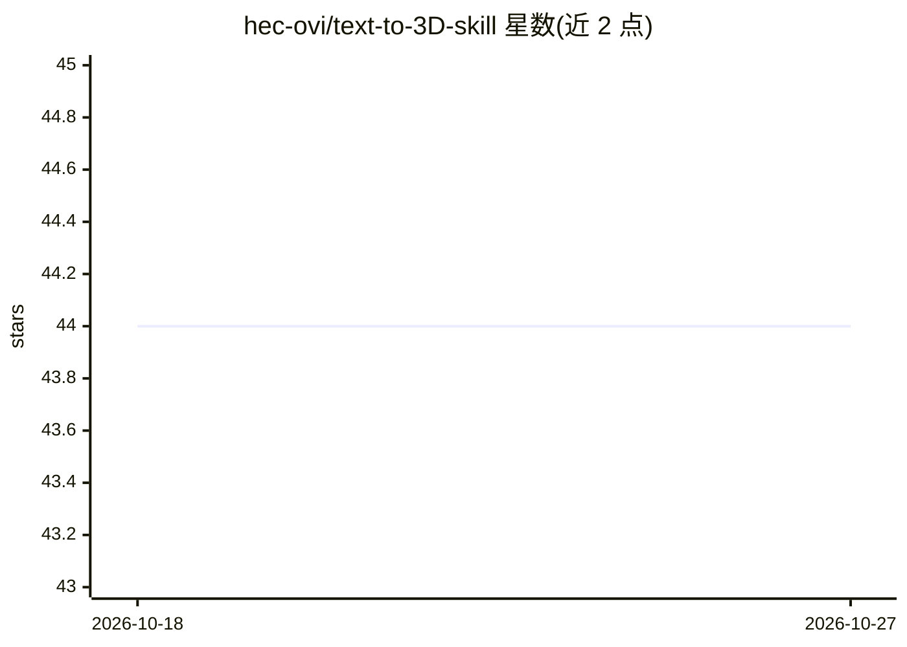

# hec-ovi/text-to-3D-skill

⭐ 44 · C++ · NOASSERTION · 推送 2026-07-28 · [GitHub](https://github.com/hec-ovi/text-to-3D-skill) · 个人维护

**AMD 核显上本地文生带贴图 GLB 并自动绑骨的 agent 技能**

面向 AMD Strix Halo（gfx1151）iGPU 的本地文生 3D 流水线技能：FLUX.2 klein 经 ComfyUI/ROCm 生成参考图，TRELLIS.2 的 C++/Vulkan 精简版重建为带贴图 GLB（支持面数预算简化），SkinTokens 在容器内经 SDPA shim 绑定人形骨架并生成 Mixamo 命名的 idle/walk 动画，全程不依赖 CUDA 与 Blender。通过 init.py 拉起两个 Docker 容器、校验权重与服务健康，各阶段返回 schema 校验的 JSON；以插件/skill 形式供 agent 调用。需约 20 GB TRELLIS 权重与同级 ComfyUI checkout。

## 筛选速览

| 维度 | 判定 | 备注 |
|---|---|---|
| AI 角色 | `ai-native` | 本体是模型或模型工具 |
| 许可风险 | `permissive` | NOASSERTION |
| 部署形态 | `library` | 以包/库形式分发 |
| 模型依赖 | — | README 未给出锁定关系 |
| 硬件要求 | — | 无带数字的原话,不猜 |
| 安装摩擦 | `medium` | 含编译或系统依赖之一 |
| 成熟度 | — | 结构信号不足 |

## 能力要点

- TRELLIS.2 的 C++/Vulkan 精简移植，去除 CUDA/HIP 内核，仅用 render node 运行
- SkinTokens 免 Blender 绑骨，输出 Mixamo 命名骨架与 idle/walk 动画并通过 Khronos glTF-Validator
- --target-faces 在 UV 展开前做二次曲率简化
- 提供 ComfyUI 单图工作流节点与本地 three.js 预览 gallery

## 适用场景

- 在没有 NVIDIA 显卡的 AMD 机器上本地生成游戏 3D 资产
- 让人形角色生成后直接绑定骨架和动画
- 通过 agent 插件命令一键驱动整条文生 3D 流水线

## 场景标签

 · 领域:3D 生成/游戏资产

## 证据(README 行号)

> L11: Type one subject description and get a textured GLB, generated on your own machine. A humanoid can then be rigged a
> L38: FLUX.2 klein renders one reference image through a ComfyUI stack on ROCm. TRELLIS.2 reconstructs that image into a 
> L40: A generated humanoid can then be rigged. SkinTokens predicts a skeleton and per-vertex weights, the driver names th

## 星数曲线

2026-10-18 44 → 2026-10-27 44（+0）

---
*卡片 v1 · prompt 1.4 · 生成 2026-10-25 · 置信度 mid · 依据 README sha `ee7359237614` · [字段定义](../../DATASET.md)*
