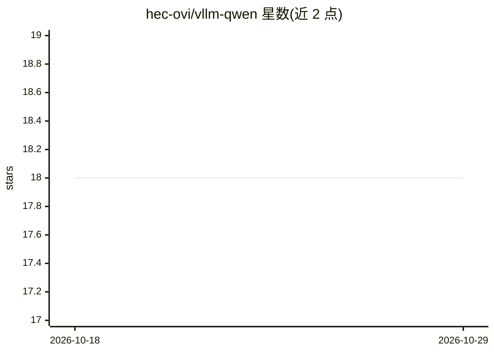

# hec-ovi/vllm-qwen

⭐ 18 · Python · Unlicense · 推送 2026-04-26 · [GitHub](https://github.com/hec-ovi/vllm-qwen) · 个人维护

**AMD Strix Halo 上用 vLLM 提供 Qwen3.6-27B BF16 推理服务的 Docker 方案**

围绕 Docker Compose 封装的推理服务部署方案：在 AMD Ryzen AI Max+ 395（Strix Halo，gfx1151，128 GB UMA）上从源码构建 vLLM（含 12 个本地补丁，基于 TheRock nightly ROCm SDK），以 OpenAI 兼容 HTTP API 提供 Qwen/Qwen3.6-27B（BF16，原生 256K 上下文）的补全、对话、Responses 端点与视觉输入。README 详细给出 BIOS VRAM 设置、GRUB TTM 参数等宿主机一次性配置，并记录冷启动约 4 分钟、解码约 4.3 t/s、显存占用约 105 GiB 等基准数据。当前工具调用受 vLLM 上游三个解析器 bug 影响；同硬件文本/工具调用场景另提供 llama.cpp 路线（llama-qwen 仓库）。

## 筛选速览

| 维度 | 判定 | 备注 |
|---|---|---|
| AI 角色 | `ai-ecosystem` | LLM/agent 周边工具 |
| 许可风险 | `permissive` | Unlicense |
| 部署形态 | `self-host` | docker 或自建部署 |
| 模型依赖 | local-ok | 支持本地模型 |
| 硬件要求 | — | 无带数字的原话,不猜 |
| 安装摩擦 | `low` | 无编译、无系统依赖或容器化 |
| 成熟度 | — | 结构信号不足 |

## 能力要点

- vLLM 从源码构建并带 12 个 Strix Halo 适配补丁（TheRock nightly ROCm）
- OpenAI 兼容端点：/v1/completions、/v1/chat/completions、/v1/responses（推理内容分离）
- 支持视觉输入与原生 256K 上下文
- README 给出完整 UMA 内存配置步骤（BIOS carve-out 最小化 + TTM 页上限调整）

## 适用场景

- 在 Strix Halo 机器上本地跑 Qwen3.6-27B 并以 OpenAI 兼容 API 对外服务
- 需要视觉理解或结构化推理输出的本地多模态推理
- 参考其在消费级 AMD iGPU 上从源码构建 vLLM/ROCm 栈的做法

## 场景标签

`推理引擎` `多模态` · 领域:感知与多模态

## 证据(README 行号)

> L20: A thin Docker Compose wrapper that runs `Qwen/Qwen3.6-27B` (BF16) behind an
> L26: vLLM is **built from source** against a TheRock nightly ROCm SDK with a
> L138: |`POST /v1/chat/completions`|OpenAI chat, with `messages` array. Supports vision via `image_url` content blocks.|

## 星数曲线

2026-10-18 18 → 2026-10-29 18（+0）

---
*卡片 v1 · prompt 1.4 · 生成 2026-10-29 · 置信度 high · 依据 README sha `9be44813517a` · [字段定义](../../DATASET.md)*
