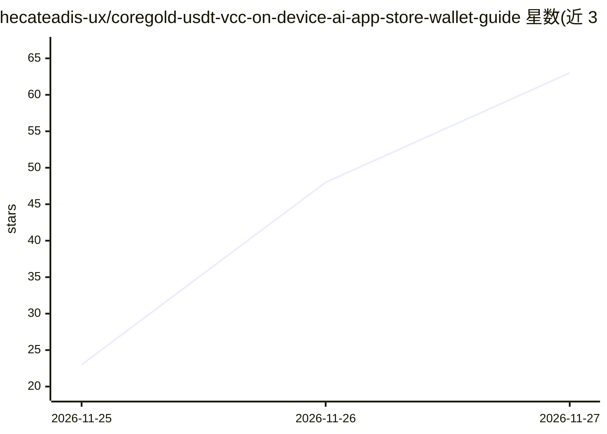

# hecateadis-ux/coregold-usdt-vcc-on-device-ai-app-store-wallet-guide

⭐ 63 · 推送 2026-11-20 · [GitHub](https://github.com/hecateadis-ux/coregold-usdt-vcc-on-device-ai-app-store-wallet-guide) · [官网](https://app.coregold.io/signup?invite_code=ADvlj9b) · 个人维护 · 中文 README

**面向移动应用付费用户的 CoreGold 虚拟卡绑卡与钱包设置指南**

一篇操作指南文档：说明如何注册 CoreGold 虚拟卡服务、通过 TRON(TRC20) 充值 USDT、选择卡计划并填写账单信息，以及将卡绑定到 Apple Pay / Google Pay 的两步邮箱验证码流程。开篇以 2026 年 11 月端侧 AI 与移动生态动态为背景，面向需要在 App Store / Google Play 购买付费应用、订阅 AI 工具及海外数字服务的用户。文档含邀请码注册链接，内容以步骤教程与支付知识为主。

## 筛选速览

| 维度 | 判定 | 备注 |
|---|---|---|
| AI 角色 | `ai-knowledge` | 知识聚合/清单类 |
| 许可风险 | `none` | — |
| 部署形态 | `None` |  |
| 模型依赖 | — | README 未给出锁定关系 |
| 硬件要求 | — | 无带数字的原话,不猜 |
| 安装摩擦 | `low` | 无编译、无系统依赖或容器化 |
| 成熟度 | — | 结构信号不足 |

## 能力要点

- 讲解设备钱包令牌化（DPAN）与生物识别验证的支付机制
- CoreGold 卡 BIN 支持 Apple Pay / Google Pay 绑定
- 两步邮箱 OTP 验证码获取流程说明
- USDT TRC20 充值与开卡、账单地址填写步骤

## 适用场景

- 在 App Store / Google Play 购买付费应用或订阅
- 为海外 AI 工具订阅设置支付方式
- 将虚拟卡绑定到手机数字钱包完成快捷支付

## 场景标签

`教程课程` · 领域:学习与行业

## 证据(README 行号)

> L2: Inspired by November 2026 on-device AI and mobile ecosystem momentum (including Apple's AI health usage study and ed
> L5: **On-Device AI & Mobile App Ecosystems: Mastering App Store & Wallet Billing**
> L27: ## Simple Step-by-Step Setup Tutorial

## 星数曲线

2026-11-25 23 → 2026-11-27 63（+40）

---
*卡片 v1 · prompt 1.4 · 生成 2026-11-24 · 置信度 high · 依据 README sha `ac2ca38e861d` · [字段定义](../../DATASET.md)*
