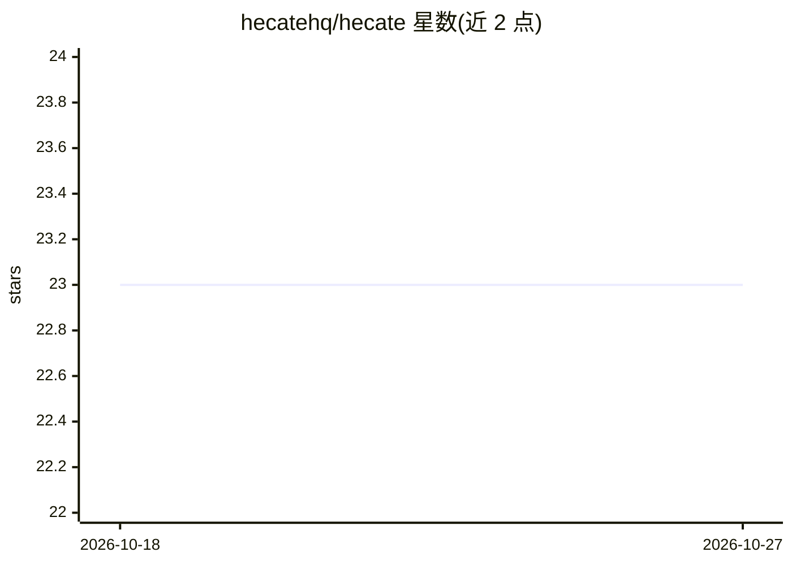

# hecatehq/hecate

⭐ 23 · Go · MIT · 推送 2026-10-26 · [GitHub](https://github.com/hecatehq/hecate) · [官网](https://hecate.sh) · 组织维护

**面向操作者的个人 AI 工作台与运行时：网关、聊天、任务、监督外部 agent**

开源的 Go 语言 AI workspace 与运行时，定位为个人控制平面：本地模型网关提供 OpenAI 兼容 Chat Completions 与 Anthropic 形态 Messages、模型发现、failover 与用量可见性；React 控制台管理聊天、连接、任务、项目与审批；原生 agent_loop 任务运行时支持审批、沙箱策略、定时调度与 MCP 集成；另可经 ACP 会话监督 Codex、Claude Code 等外部编码 agent CLI，并提供 hecate acp serve 让 ACP 客户端调用其原生任务运行时。可作桌面应用（macOS 测试最多，Linux/Windows 实验性）、Docker 或源码运行。自述 pre-1.0、尚未 production-stable，沙箱非容器级隔离。Hecate Cloud 为独立的托管产品。

## 筛选速览

| 维度 | 判定 | 备注 |
|---|---|---|
| AI 角色 | `ai-ecosystem` | LLM/agent 周边工具 |
| 许可风险 | `permissive` | MIT |
| 部署形态 | `desktop` | 安装包/桌面程序 |
| 模型依赖 | local-ok | 支持本地模型 |
| 硬件要求 | — | 无带数字的原话,不猜 |
| 安装摩擦 | `low` | 无编译、无系统依赖或容器化 |
| 成熟度 | `idea` | |

## 能力要点

- 本地模型网关：OpenAI 兼容与 Anthropic 形态接口、failover、限流、用量与提供商健康
- 原生 agent_loop 任务运行时：审批、Work policy、cron 调度、重试/恢复、MCP 工具集成
- 经 ACP 会话监督 Codex / Claude Code / Cursor Agent / Grok Build 等外部编码 agent，含 Git diff 审查
- OpenTelemetry 追踪/指标/日志与本地 trace 视图

## 适用场景

- 在一处集中管理模型聊天、项目与 agent 任务并审批高风险操作
- 用统一本地 /v1 网关路由多个模型提供商给本地应用与工具
- 监督并审查外部编码 agent CLI 在本机上的会话与改动

## 场景标签

`模型网关` `Agent 框架` `AI 助手` · 领域:Agent 开发

## 证据(README 行号)

> L58: - **Gateway:** one local API for OpenAI-compatible Chat Completions,
> L63: - **Native runtime:** queued task runs, tool-calling `agent_loop`, approvals,
> L127: |**Model gateway**|OpenAI-compatible Chat Completions, Anthropic-shaped Messages, streaming, vision, model discove

## 星数曲线

2026-10-18 23 → 2026-10-27 23（+0）

---
*卡片 v1 · prompt 1.4 · 生成 2026-10-27 · 置信度 high · 依据 README sha `9f29544824fc` · [字段定义](../../DATASET.md)*
