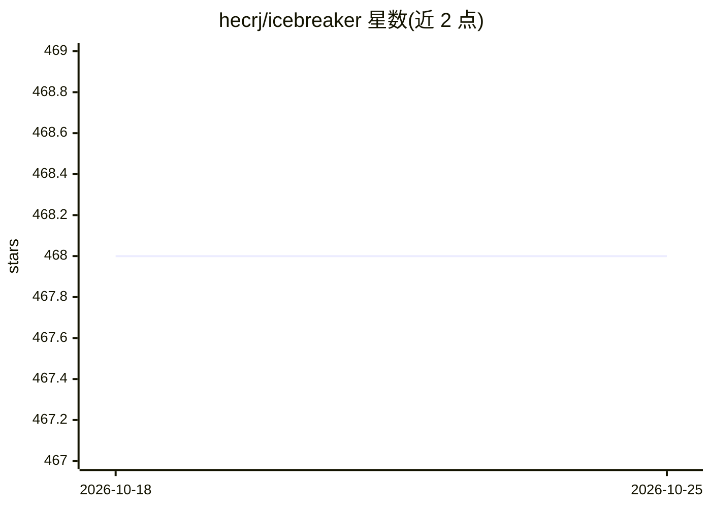

# hecrj/icebreaker

⭐ 467 · Rust · MIT · 推送 2026-08-28 · [GitHub](https://github.com/hecrj/icebreaker) · 个人维护

**本地运行的桌面 AI 聊天应用，基于 Rust 与 llama.cpp**

用 Rust 与 iced GUI 框架构建的本地 AI 聊天应用，模型侧集成 Hugging Face 与 llama.cpp，模型在本地运行。目前无预编译二进制，需通过 cargo install 从 Crates.io 或直接从 GitHub master 分支构建安装。README 较简短，功能细节披露有限，项目含 Crates.io 发布、License、Downloads 与 Test Status 徽章。

## 筛选速览

| 维度 | 判定 | 备注 |
|---|---|---|
| AI 角色 | `ai-native` | 本体是模型或模型工具 |
| 许可风险 | `permissive` | MIT |
| 部署形态 | `library` | 以包/库形式分发 |
| 模型依赖 | — | README 未给出锁定关系 |
| 硬件要求 | — | 无带数字的原话,不猜 |
| 安装摩擦 | `low` | 无编译、无系统依赖或容器化 |
| 成熟度 | — | 结构信号不足 |

## 能力要点

- 基于 Rust 与 iced 的本地聊天界面
- 集成 Hugging Face 与 llama.cpp
- 通过 cargo 可从 Crates.io 或源码安装

## 适用场景

- 在本地与开源大模型对话
- 无需外部 API 服务的桌面聊天客户端

## 场景标签

`聊天机器人` · 领域:对话与助手

## 证据(README 行号)

> L9: A local AI chat app powered by 🦀 Rust, 🧊 iced, 🤗 Hugging Face, and 🦙 llama.cpp
> L15: No pre-built binaries yet! Use `cargo` to try out the latest release:

## 星数曲线

2026-10-18 468 → 2026-10-25 468（+0）

---
*卡片 v1 · prompt 1.4 · 生成 2026-10-21 · 置信度 high · 依据 README sha `af2e4dc85e46` · [字段定义](../../DATASET.md)*
