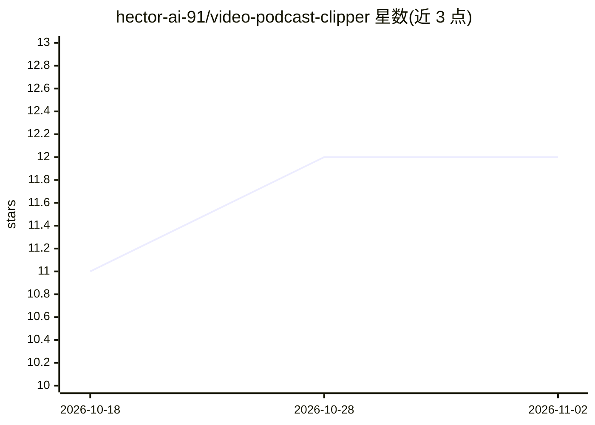

# hector-ai-91/video-podcast-clipper

⭐ 12 · Python · MIT · 推送 2026-10-14 · [GitHub](https://github.com/hector-ai-91/video-podcast-clipper) · 个人维护

**将长视频转为竖屏短视频的本地流水线：AI 评分选段+人脸跟踪裁剪+动画字幕**

面向播客主、内容营销机构与独立创作者的本地视频剪辑流水线：faster-whisper 做词级转录，8 维度神经参与度评分（65 分阈值）筛选候选片段，MediaPipe FaceLandmarker（468 点）逐帧跟踪人脸生成 9:16 智能裁剪，Remotion 渲染逐词动画字幕，并输出 YouTube Shorts/TikTok/Reels 三平台编码预设。可用单条 agent 提示词驱动（Claude Code/Cursor/Codex/Hermes），也可逐脚本手动运行；全流程本地运行无 API 费用，需 Python 3.8+ 与 ffmpeg。

## 筛选速览

| 维度 | 判定 | 备注 |
|---|---|---|
| AI 角色 | `ai-native` | 本体是模型或模型工具 |
| 许可风险 | `permissive` | MIT |
| 部署形态 | `library` | 以包/库形式分发 |
| 模型依赖 | — | README 未给出锁定关系 |
| 硬件要求 | — | 无带数字的原话,不猜 |
| 安装摩擦 | `medium` | 含编译或系统依赖之一 |
| 成熟度 | `idea` | |

## 能力要点

- 8 维度评分体系（钩子强度、情绪弧线、跨模态同步等），65/100 最低阈值
- MediaPipe 468 点人脸跟踪驱动的 9:16 竖屏智能裁剪，自动处理分屏
- Remotion 三种风格动画字幕，自动去除填充词
- YouTube Shorts / TikTok / Instagram Reels 三平台导出预设，支持 NVENC 加速

## 适用场景

- 把 60 分钟播客长视频转成 8-12 条平台可发布的竖屏短片
- 让 AI coding agent 用一条提示词跑完整条剪辑流水线
- 不依赖云服务、在本地零 API 费用地批量剪辑客户视频

## 场景标签

`图像视频处理` · 领域:感知与多模态

## 证据(README 行号)

> L14: Video Podcast Clipper scores every segment the way a brain does — using an 8-dimension model informed by Meta's Tri
> L40: - **Face-tracked vertical crop** — MediaPipe FaceLandmarker (468-point mesh) follows the speaker's face frame by fr
> L93: ### 1. Transcribe

## 星数曲线

2026-10-18 11 → 2026-11-02 12（+1）

---
*卡片 v1 · prompt 1.4 · 生成 2026-11-01 · 置信度 mid · 依据 README sha `9cce82e6b496` · [字段定义](../../DATASET.md)*
