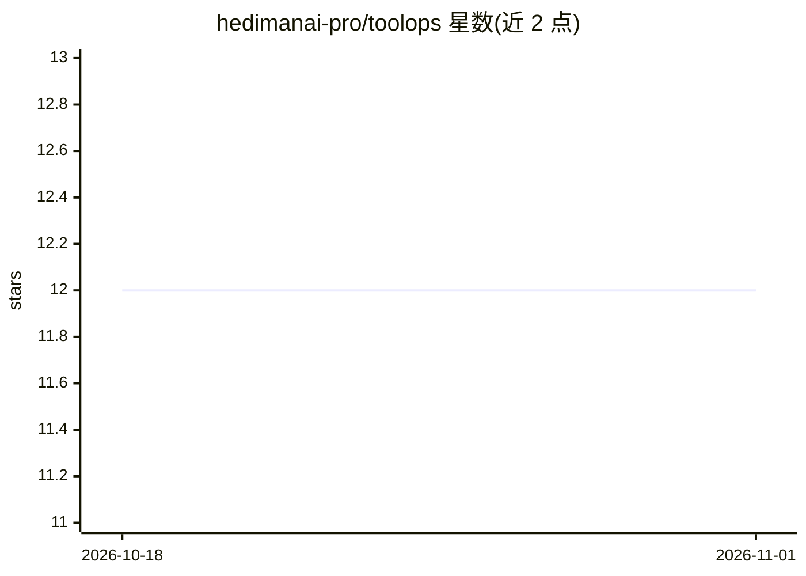

# hedimanai-pro/toolops

⭐ 12 · Python · Apache-2.0 · 推送 2026-05-30 · [GitHub](https://github.com/hedimanai-pro/toolops) · [官网](https://hedimanai.vercel.app/projects/toolops.html) · 个人维护 · 中文 README

**AI Agent 工具调用的中间件 SDK：装饰器加缓存/熔断/观测**

框架无关的 Python 中间件 SDK，用单个装饰器包装任意函数，为 AI agent 的外部调用（LLM、API、DB）提供缓存、重试、熔断、请求合并、降级回退与可观测性。缓存后端覆盖内存、文件、SQLite、Postgres、MySQL、Valkey/Redis 及基于嵌入的语义缓存，默认安装即含全部后端与 OpenTelemetry/Prometheus 工具；缓存键经 SHA-256 哈希并对敏感参数自动打码。提供 CLI 管理缓存后端健康，兼容 LangChain/LangGraph、CrewAI，可生成 MCP 工具定义。面向构建生产级 agent 的开发者。

## 筛选速览

| 维度 | 判定 | 备注 |
|---|---|---|
| AI 角色 | `ai-ecosystem` | LLM/agent 周边工具 |
| 许可风险 | `permissive` | Apache-2.0 |
| 部署形态 | `library` | 以包/库形式分发 |
| 模型依赖 | — | README 未给出锁定关系 |
| 硬件要求 | — | 无带数字的原话,不猜 |
| 安装摩擦 | `low` | 无编译、无系统依赖或容器化 |
| 成熟度 | — | 结构信号不足 |

## 能力要点

- 单装饰器为工具调用添加缓存、重试、熔断、请求合并与降级回退
- 多缓存后端（SQLite/Postgres/MySQL/Valkey/Redis 及语义缓存）默认全量安装
- OpenTelemetry 与 Prometheus 自动埋点（缓存命中/延迟/熔断指标）
- SHA-256 缓存键哈希与敏感参数自动打码

## 适用场景

- 给 agent 的 LLM/API 调用加语义缓存以减少重复请求
- 生产环境为不稳定的外部工具调用加熔断与重试保护
- 通过 OpenTelemetry/Prometheus 监控 agent 工具调用延迟与缓存命中

## 场景标签

`Agent 框架` `LLM 可观测性` · 领域:Agent 开发

## 证据(README 行号)

> L26: ToolOps eliminates the boilerplate. It is a framework-agnostic middleware SDK that wraps any Python function in a s
> L161: ### LangChain / LangGraph

## 星数曲线

2026-10-18 12 → 2026-11-01 12（+0）

---
*卡片 v1 · prompt 1.4 · 生成 2026-11-01 · 置信度 high · 依据 README sha `f4f9e61d89e1` · [字段定义](../../DATASET.md)*
