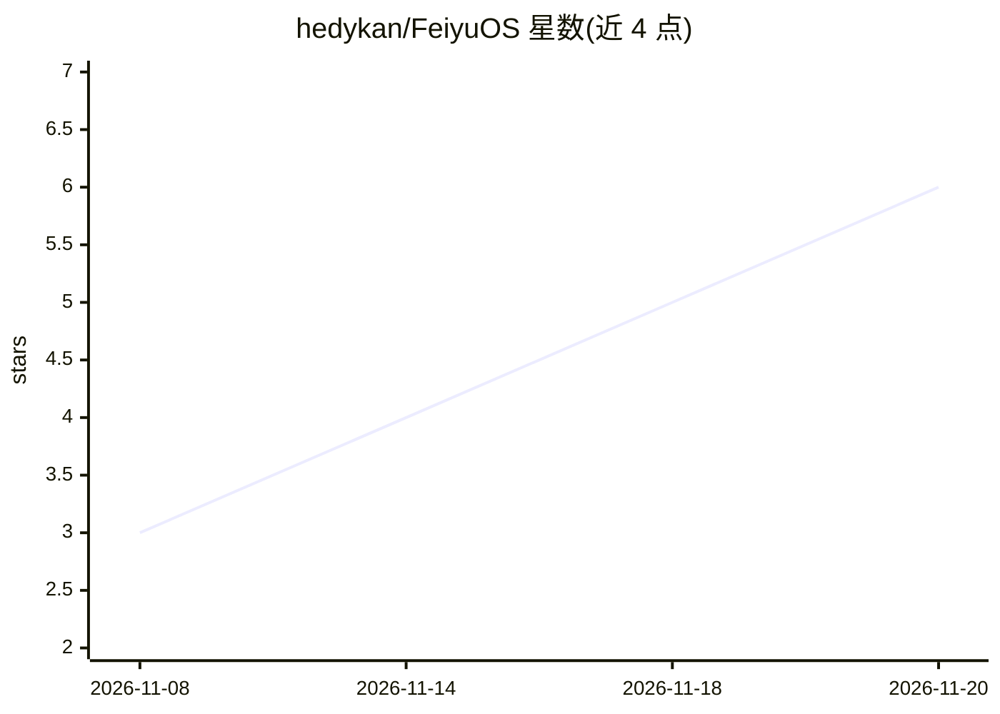

# hedykan/FeiyuOS

⭐ 6 · C++ · MIT · 推送 2026-11-14 · [GitHub](https://github.com/hedykan/FeiyuOS) · 个人维护 · 中文 README

**跑在 Cardputer 上的语音控制嵌入式 AI 小操作系统**

运行在 M5Stack Cardputer Adv（ESP32-S3）上的应用层，基于 ESP-IDF/FreeRTOS，以大语言模型为 Shell：按住按键说话，语音识别（通义千问）与模型（DeepSeek）在云端，设备端完成录音、Agent 循环与执行，把语音翻译为对本机屏幕、灯、传感器、TF 卡、红外、蓝牙、LoRa、SSH 远端会话等 URI 资源的操作。常用操作可由模型写成 Lua 程序存卡，支持定时/开机/事件触发；能力以扩展包形式挂载，含在线目录安装。写操作需设备上按 Y 确认。

## 筛选速览

| 维度 | 判定 | 备注 |
|---|---|---|
| AI 角色 | `ai-native` | 本体是模型或模型工具 |
| 许可风险 | `permissive` | MIT |
| 部署形态 | `library` | 以包/库形式分发 |
| 模型依赖 | locked-api |  |
| 硬件要求 | — | 无带数字的原话,不猜 |
| 安装摩擦 | `low` | 无编译、无系统依赖或容器化 |
| 成熟度 | — | 结构信号不足 |

## 能力要点

- 以 URI 命名空间统一暴露本机与远端资源，七个通用工具（discover/read/write/exec 等）调用
- 模型可生成 Lua 5.4 程序存卡，支持定时、开机与事件触发
- 扩展包机制：内置二十多个，卡上 Lua 文件可成扩展包，在线目录一键安装与更新
- 写入与物理动作需设备上按 Y 确认，程序权限保存时确认一次

## 适用场景

- 用一句话控制开发板上的屏幕、灯、传感器和红外设备
- 让 AI 生成定时任务小程序存卡上反复运行
- 通过语音接入远端 SSH/tmux 开发机并指挥 Codex 类会话

## 场景标签

`语音 Agent` · 领域:对话与助手

## 证据(README 行号)

> L3: 跑在 M5Stack Cardputer Adv 上的 AI 原生小操作系统：按住说一句话，大肥鱼（DeepSeek）把它翻译成对资源的操作——本机的屏幕、灯、提示音、传感器、TF 卡文件、提醒、红外、蓝牙、GPS、LoRa，高德的
> L11: 肥鱼 OS 是跑在 ESP-IDF / FreeRTOS 之上的应用层，内核仍是 FreeRTOS。它做的是操作系统用户空间的那部分：
> L25: 录音、Agent 循环、程序运行、SSH、界面和设置都在设备上；语音识别（通义千问）和大模型（DeepSeek）在云端，由设备直接调用。电脑只用于编译和刷写固件，运行时不需要任何电脑进程。旧名 Voice Agent Termin

## 星数曲线

2026-11-08 3 → 2026-11-20 6（+3）

---
*卡片 v1 · prompt 1.4 · 生成 2026-11-20 · 置信度 mid · 依据 README sha `4b0213b4b14b` · [字段定义](../../DATASET.md)*
