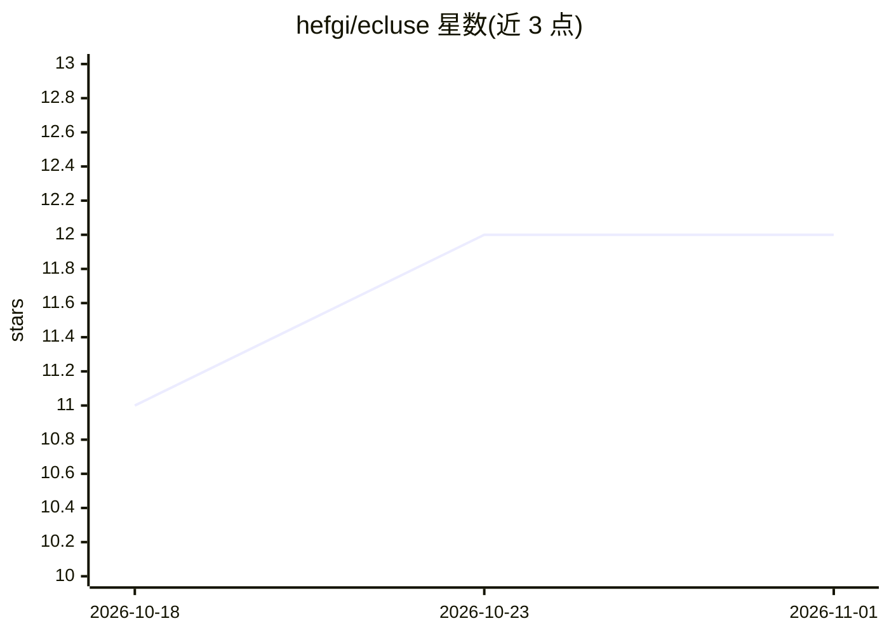

# hefgi/ecluse

⭐ 12 · Rust · Apache-2.0 · 推送 2026-10-02 · [GitHub](https://github.com/hefgi/ecluse) · [官网](https://hefgi.github.io/ecluse/) · 个人维护

**给编码 agent 的临时本地开发环境工具：并行隔离、无冲突**

Rust 编写的 CLI，为并行运行的编码 agent（Claude Code、Cursor、Codex 等）提供基于 git worktree 的临时开发环境：每个会话分配独立 slot，派生隔离端口、Compose 项目名与命名卷，支持 container/hybrid/host 三种模式，用完即干净拆除。通过 ecluse init 检测模式并写 .ecluse.toml，up/down/shell/env 等命令管理生命周期，tmux 或 nohup 拉起本地服务。限制：端口只检查不预留，不监控崩溃进程，应用需从环境变量读取端口。

## 筛选速览

| 维度 | 判定 | 备注 |
|---|---|---|
| AI 角色 | `ai-ecosystem` | LLM/agent 周边工具 |
| 许可风险 | `permissive` | Apache-2.0 |
| 部署形态 | `self-host` | docker 或自建部署 |
| 模型依赖 | — | README 未给出锁定关系 |
| 硬件要求 | — | 无带数字的原话,不猜 |
| 安装摩擦 | `low` | 无编译、无系统依赖或容器化 |
| 成熟度 | — | 结构信号不足 |

## 能力要点

- 每个 git worktree 一个 slot，端口/服务/数据全隔离
- container/hybrid/host 三模式，支持 Docker 与宿主混跑
- ecluse up 幂等、soft restart 保留 worktree、端口实际监听探测
- 提供 hooks（pre_up/post_up 等）与 port_env 环境变量注入

## 适用场景

- 并行跑多个 coding agent 会话互不抢端口
- 为每个特性分支快速起独立栈并验证（build/migrate/test/e2e）
- monorepo 多服务按 slot 分配无冲突端口

## 场景标签

 · 领域:开发者工具/本地环境编排

## 证据(README 行号)

> L14: **Built for coding agents running tasks in parallel.**
> L28: ecluse gives each agent its own slot: isolated ports, its own services, its own infra. All 4 agents spin up, verify

## 星数曲线

2026-10-18 11 → 2026-11-01 12（+1）

---
*卡片 v1 · prompt 1.4 · 生成 2026-11-01 · 置信度 mid · 依据 README sha `8bcd7013872b` · [字段定义](../../DATASET.md)*
