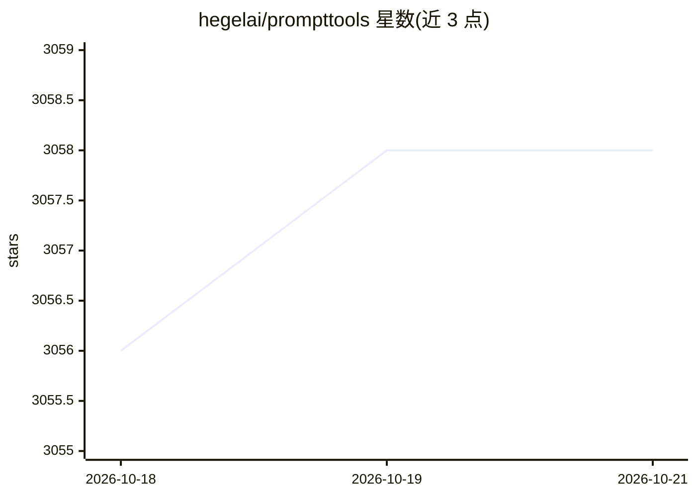

# hegelai/prompttools

⭐ 3,058 · Python · Apache-2.0 · 推送 2026-02-11 · [GitHub](https://github.com/hegelai/prompttools) · [官网](http://prompttools.readthedocs.io) · 组织维护

**给开发者的 LLM 与向量数据库提示词测试评测工具集**

Hegel AI 维护的开源自托管 Python 库，用于实验、测试与评估 LLM、向量数据库与提示词。开发者通过代码、Jupyter notebook 或本地 Streamlit playground 界面，在不同模型与参数组合上对比提示词效果，也可评测向量数据库的检索准确率。集成覆盖 OpenAI、Anthropic、LLaMA.Cpp、HuggingFace、Mistral、Gemini 等多种 API 以及 Chroma、Weaviate、Qdrant、LanceDB、Pinecone 等。代码本地执行，不转发调用，结果可导出 CSV/JSON/MongoDB。通过 pip 安装。

## 筛选速览

| 维度 | 判定 | 备注 |
|---|---|---|
| AI 角色 | `ai-ecosystem` | LLM/agent 周边工具 |
| 许可风险 | `permissive` | Apache-2.0 |
| 部署形态 | `library` | 以包/库形式分发 |
| 模型依赖 | locked-api |  |
| 硬件要求 | — | 无带数字的原话,不猜 |
| 安装摩擦 | `low` | 无编译、无系统依赖或容器化 |
| 成熟度 | `idea` | |

## 能力要点

- 代码/notebook/本地 playground 三种界面进行提示词实验
- 支持 OpenAI、Anthropic、LLaMA.Cpp、HuggingFace、Mistral、Gemini 等 LLM 集成
- 支持 Chroma、Weaviate、Qdrant、LanceDB、Pinecone 等向量数据库检索评测
- 实验结果可导出 CSV/JSON/LoRA JSON/MongoDB

## 适用场景

- 跨模型与参数组合对比提示词效果
- 评测向量数据库的检索准确率
- 在 notebook 或本地 playground 中迭代提示词实验

## 场景标签

`提示工程` `模型评测` · 领域:Agent 开发

## 证据(README 行号)

> L11: Welcome to `prompttools` created by Hegel AI! This repo offers a set of open-source, self-hostable tools for experi
> L73: Here is a list of APIs that we support with our experiments:

## 星数曲线

2026-10-18 3,056 → 2026-10-21 3,058（+2）

---
*卡片 v1 · prompt 1.4 · 生成 2026-10-20 · 置信度 high · 依据 README sha `1becec103baa` · [字段定义](../../DATASET.md)*
