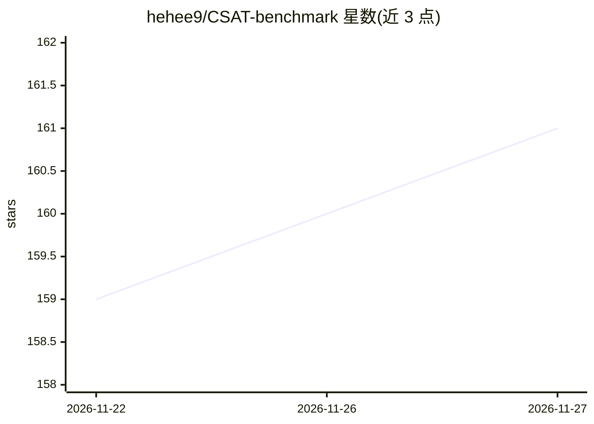

# hehee9/CSAT-benchmark

⭐ 161 · Python · NOASSERTION · 推送 2026-11-25 · [GitHub](https://github.com/hehee9/CSAT-benchmark) · [官网](https://hehee9.github.io/CSAT-benchmark/) · 个人维护

**韩国高考（수능）各 LLM 解题成绩的数据记录库**

记录并统计多款 LLM 解答韩国大学入学考试（수능/模拟考）题目的结果数据：覆盖国语、数学、英语、韩国史及探究科目，按模型汇总分数、图文题得分率、API 成本与 token 用量，并通过交互式 Dashboard 展示。测试经各模型官方 API 进行，不提供系统提示词与外部工具；题目经 OCR 转文本、公式转 LaTeX 后输入。仓库以数据与统计为主，MIT 许可发布，不含试题原文，另附自行运行基准的使用指南。

## 筛选速览

| 维度 | 判定 | 备注 |
|---|---|---|
| AI 角色 | `ai-knowledge` | 知识聚合/清单类 |
| 许可风险 | `permissive` | NOASSERTION |
| 部署形态 | `None` |  |
| 模型依赖 | — | README 未给出锁定关系 |
| 硬件要求 | — | 无带数字的原话,不猜 |
| 安装摩擦 | `low` | 无编译、无系统依赖或容器化 |
| 成熟度 | — | 结构信号不足 |

## 能力要点

- 覆盖 2026/2027 수능 多科目、450 分制综合成绩统计
- 测试数十款模型（OpenAI/Google/Anthropic/xAI/DeepSeek/Qwen 及韩系模型等）
- 图文题与纯文本题得分率对比、成本-性能相关性分析
- 提供在线 Dashboard 与自行复测的使用指南

## 适用场景

- 查看特定模型在韩国高考各科目上的解题成绩
- 比较各模型的 API 成本与得分效率
- 参考其出题输入格式自行运行同类基准

## 场景标签

`模型评测` · 领域:评测与运维

## 证据(README 行号)

> L17: 다양한 LLM 모델의 수능 / 모의고사 문제 풀이 결과를 기록하고 통계를 정리한 데이터입니다.
> L25: 직접 벤치마크를 실행하려면 사용 가이드를 참고하세요.
> L66: **각 모델의 공식 API를 통해 진행되었습니다.**

## 星数曲线

2026-11-22 159 → 2026-11-27 161（+2）

---
*卡片 v1 · prompt 1.4 · 生成 2026-11-27 · 置信度 high · 依据 README sha `e7b1c5f60e9f` · [字段定义](../../DATASET.md)*
