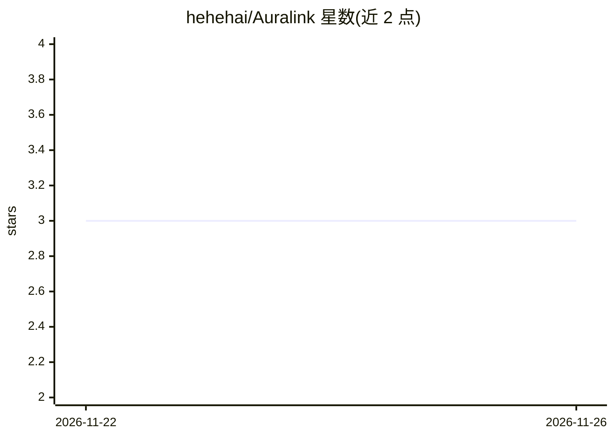

# hehehai/Auralink

⭐ 3 · Go · AGPL-3.0 · 推送 2026-11-23 · [GitHub](https://github.com/hehehai/Auralink) · [官网](https://actnow.dev/auralink) · 个人维护 · 中文 README

**macOS 全局语音输入工具：说话转文字到光标处**

面向 macOS 的菜单栏语音输入应用：在任意应用按快捷键说话，语音经远程语音识别服务转写，再由语言模型清理（去口头语、修标点），输入到光标处；同时支持选中文本的翻译与按口述指令改写。不本地运行模型，用户自带 StepFun、豆包、阿里云、DeepSeek、OpenAI 等服务的 API key，密钥存于 macOS Keychain。提供应用级场景提示、术语词典、静音裁剪与增益处理、历史记录与自动更新。需 macOS 15+ 与 Apple silicon，状态为 beta。

## 筛选速览

| 维度 | 判定 | 备注 |
|---|---|---|
| AI 角色 | `ai-native` | 本体是模型或模型工具 |
| 许可风险 | `viral` | AGPL-3.0 |
| 部署形态 | `desktop` | 安装包/桌面程序 |
| 模型依赖 | locked-api |  |
| 硬件要求 | — | 无带数字的原话,不猜 |
| 安装摩擦 | `low` | 无编译、无系统依赖或容器化 |
| 成熟度 | `idea` | |

## 能力要点

- 三类功能：转写、翻译、改写，均支持自定义快捷键
- 应用级场景提示与含别名的术语词典，按应用/网站匹配
- 录音前的信号处理：高通滤波、增益、静音裁剪
- API key 存于 macOS Keychain，无账号、无使用数据收集

## 适用场景

- 在任意应用里用语音代替打字输入文字
- 选中文字后口述指令完成翻译或改写
- 聊天、邮件等不同应用按场景自动调整输出风格

## 场景标签

`语音识别` `AI 写作` · 领域:内容生成

## 证据(README 行号)

> L14: Auralink is a small voice input app for macOS. Press a shortcut in any app, speak, and the text is typed at the cur
> L16: It runs no models on your Mac. You choose the speech and language services (StepFun, Doubao, Alibaba Cloud, DeepSee
> L103: At least one speech service is required. A language model is needed for the clean-up, Translate and Rewrite.

## 星数曲线

2026-11-22 3 → 2026-11-26 3（+0）

---
*卡片 v1 · prompt 1.4 · 生成 2026-11-22 · 置信度 high · 依据 README sha `afdf3eaa7883` · [字段定义](../../DATASET.md)*
