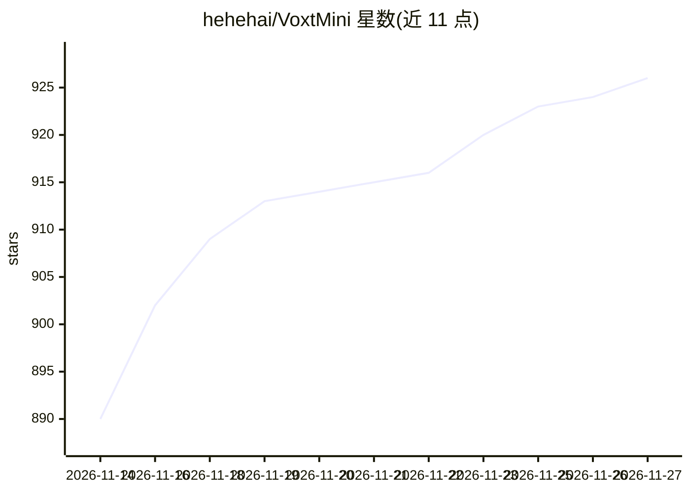

# hehehai/VoxtMini

⭐ 926 · Go · Apache-2.0 · 推送 2026-11-26 · [GitHub](https://github.com/hehehai/VoxtMini) · [官网](https://actnow.dev/voxtmini) · 组织维护 · 中文 README

**macOS 本地模型语音输入工具：任意应用内转写、翻译与改写**

VoxtMini 是 Voxt 的继任者，用 Go 重写：在任意应用中按快捷键说话，文本出现在光标处。支持三类功能——语音转文字（可选 LLM 清理填充词）、翻译为英文/中文/日文、口述改写选中文本，另有应用增强、自定义词典与历史记录（含录音回放与追问）。模型以本地为默认（MLX 上的 Qwen3-ASR/Whisper 及语言模型），可选 Apple Speech 或远程服务；需 Apple silicon 芯片、macOS 15+，建议 16 GB 内存，当前为 beta。

## 筛选速览

| 维度 | 判定 | 备注 |
|---|---|---|
| AI 角色 | `ai-native` | 本体是模型或模型工具 |
| 许可风险 | `permissive` | Apache-2.0 |
| 部署形态 | `None` |  |
| 模型依赖 | local-ok | 支持本地模型 |
| 硬件要求 | — | 无带数字的原话,不猜 |
| 安装摩擦 | `low` | 无编译、无系统依赖或容器化 |
| 成熟度 | — | 结构信号不足 |

## 能力要点

- 快捷键在任意应用内实时转写，可选语言模型清理文本与结束词
- 本地模型为默认：MLX 上的 Qwen3-ASR、Whisper 及多个语言模型
- 口述改写选中文本，并支持在回答卡片中追问
- 自定义词典按类别管理术语，历史记录保留录音可重试

## 适用场景

- 在聊天或文档中口述输入文字而不打字
- 把选中的文本口令式改写为更简短或更正式的版本
- 将语音内容翻译为英文/中文/日文
- 离线使用，音频与文本不出本机

## 场景标签

`语音识别` `AI 写作` · 领域:内容生成

## 证据(README 行号)

> L5: Voice input for macOS on local models: press a shortcut in any app, speak, and the text appears at your cursor.
> L57: - **Local** (the default): Qwen3-ASR and Whisper for speech, Qwen3.5, Hy-MT2 and more for language, on MLX. Downloa

## 星数曲线

2026-11-14 890 → 2026-11-27 926（+36）

---
*卡片 v1 · prompt 1.4 · 生成 2026-11-24 · 置信度 high · 依据 README sha `9cf48e8be954` · [字段定义](../../DATASET.md)*
