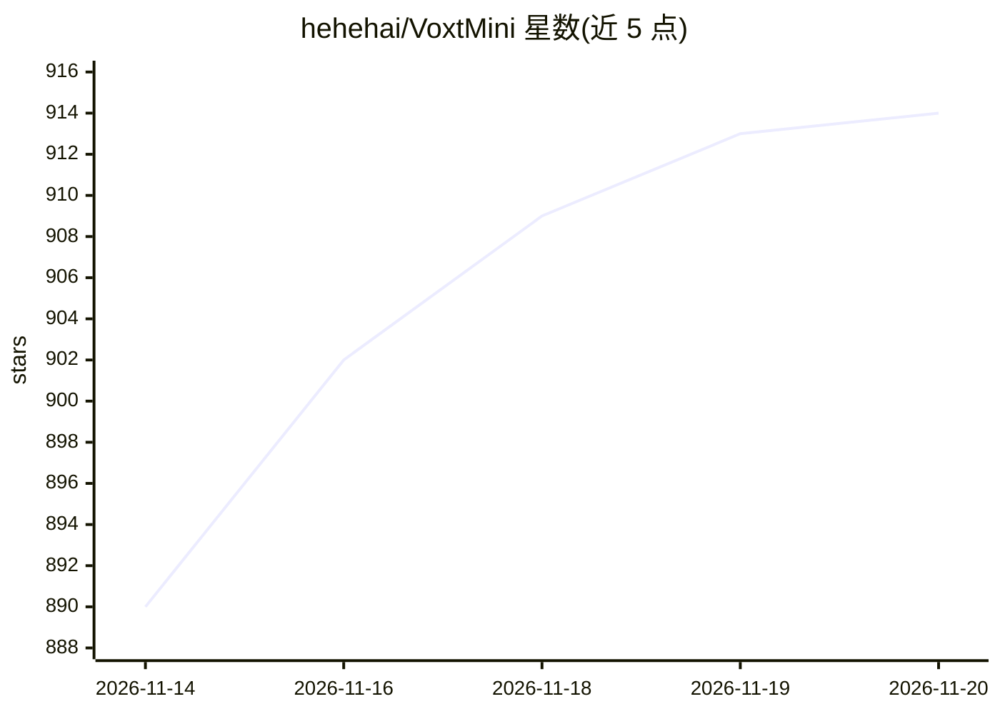

# hehehai/VoxtMini

⭐ 914 · Go · Apache-2.0 · 推送 2026-11-17 · [GitHub](https://github.com/hehehai/VoxtMini) · [官网](https://actnow.dev) · 个人维护 · 中文 README

**macOS 本地模型语音输入工具：听写、翻译与改写**

面向 macOS 用户的语音输入应用：在任意应用中按快捷键说话，文字实时出现在光标处；支持语音转文字（可选语言模型清理语气词与加标点）、翻译为中/英/日、选中文本后口述指令改写并追问。模型默认本地运行（Qwen3-ASR、Whisper、MLX），也可选 OpenAI、Gemini、Anthropic、DeepSeek、Ollama 等远程或本机服务。需 Apple silicon 与 macOS 15+，16GB 内存较舒适；当前为 beta。

## 筛选速览

| 维度 | 判定 | 备注 |
|---|---|---|
| AI 角色 | `ai-native` | 本体是模型或模型工具 |
| 许可风险 | `permissive` | Apache-2.0 |
| 部署形态 | `None` |  |
| 模型依赖 | local-ok | 支持本地模型 |
| 硬件要求 | — | 无带数字的原话,不猜 |
| 安装摩擦 | `low` | 无编译、无系统依赖或容器化 |
| 成熟度 | `idea` | |

## 能力要点

- 快捷键触发的实时听写，可选结束词停止录音
- 按应用/网站分组设置提示词与插入后按键
- 本地 MLX 模型为主，音频与文本默认留在本机
- 词典功能：名称与术语按用户写法转写

## 适用场景

- 在任意应用中用语音输入文字替代打字
- 说话即时翻译成英文、中文或日文
- 选中文字后用语音指令改写（更短、更正式等）

## 场景标签

`语音识别` · 领域:感知与多模态

## 证据(README 行号)

> L23: - Live text while you speak, an optional clean-up by a language model (fillers out, punctuation in)
> L51: - **Local** (the default): Qwen3-ASR and Whisper for speech, Qwen3.5, Hy-MT2 and more for language, on MLX. Downloa

## 星数曲线

2026-11-14 890 → 2026-11-20 914（+24）

---
*卡片 v1 · prompt 1.4 · 生成 2026-11-17 · 置信度 high · 依据 README sha `c0e00cb35152` · [字段定义](../../DATASET.md)*
