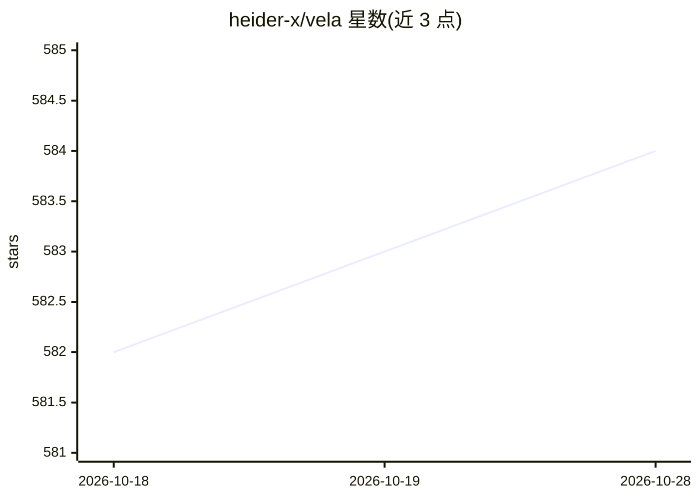

# heider-x/vela

⭐ 585 · TypeScript · GPL-3.0 · 推送 2026-10-19 · [GitHub](https://github.com/heider-x/vela) · [官网](https://github.com/heider-x/vela) · 个人维护 · 中文 README

**面向网文与小说作者的本地优先 AI 写作 IDE**

基于 Electron + React 的桌面端小说创作 IDE，面向网文作者、独立作家与创意写作者。提供 AI 驱动的全流程工作流：世界观与角色设定管理、自动大纲生成、流式章节起草、智能重写、语病精修与剧情自评审阅，并以 Rewrite→Refine→Review 三级管线串联。内置 SQLite 与轻量向量引擎的本地 RAG 知识库，可导入百万字级设定并语义检索，断网可用。模型采用 BYOK，兼容 OpenAI、DeepSeek、Gemini、Claude、Ollama 等服务商，支持按任务分流与 MCP 协议扩展。提供 macOS/Windows 安装包与源码构建两种方式，GPL-3.0 协议另可洽谈闭源商用授权。

## 筛选速览

| 维度 | 判定 | 备注 |
|---|---|---|
| AI 角色 | `ai-native` | 本体是模型或模型工具 |
| 许可风险 | `viral` | GPL-3.0 |
| 部署形态 | `desktop` | 安装包/桌面程序 |
| 模型依赖 | local-ok | 支持本地模型 |
| 硬件要求 | — | 无带数字的原话,不猜 |
| 安装摩擦 | `low` | 无编译、无系统依赖或容器化 |
| 成熟度 | — | 结构信号不足 |

## 能力要点

- 大纲生成→章节起草→重写→精修→评审的自动化创作管线
- 本地 RAG 知识库（SQLite + 轻量向量引擎），断网可用
- BYOK 多服务商接入（OpenAI/DeepSeek/Gemini/Claude/Ollama/智谱等）并支持按任务分流
- IDE 级四分屏布局与 MCP 协议工具扩展

## 适用场景

- 长篇网文创作中保持人设与世界观设定一致
- 从大纲到正文的一键章节生成与自动审阅
- 导入参考小说与设定集，写作时自动召回相关设定

## 场景标签

`AI 写作` `RAG` · 领域:内容生成

## 证据(README 行号)

> L16: > **Vela** 是一款开源、隐私优先、本地优先的 AI 写作 IDE，专为**长篇小说创作 (Novel Writing)**、**网文写手 (Web Fiction)**与**创意写作 (Creative Writing)
> L52: |✍️ 流式章节正文生成 (Chapter Drafting)|单章流式打字机生成，精准响应前文上下文与预设提纲，随时可中止|
> L63: |🔍 语义向量检索 (Vector Search)|写作时根据当前章节语义自动召回最相关的设定切片 (Chunk)，告别人设崩塌与设定遗忘|

## 星数曲线

2026-10-18 582 → 2026-10-28 584（+2）

---
*卡片 v1 · prompt 1.4 · 生成 2026-10-21 · 置信度 high · 依据 README sha `1f151b3789a6` · [字段定义](../../DATASET.md)*
