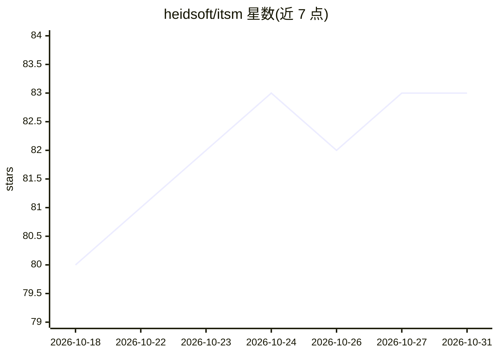

# heidsoft/itsm

⭐ 83 · Go · Apache-2.0 · 推送 2026-10-30 · [GitHub](https://github.com/heidsoft/itsm) · [官网](https://github.com/heidsoft/itsm) · 个人维护 · 中文 README

**面向国内企业的开源 ITIL 服务管理系统（Go + Next.js）**

覆盖 ITIL 核心流程的企业级 ITSM 系统：工单、事件、问题、变更、SLA、CMDB、BPMN 2.0 工作流、知识库与 RBAC 多租户。AI 定位为辅助（LLM Gateway、分诊、摘要、RAG），要求可降级、留审计且不绕过人工审批；另有 MCP server 让 Agent 直接操作 268 条命令。异步操作用事务 + outbox 模式保证可靠。多数核心流程已可用，服务目录、BPMN、AI 辅助、报表等仍为预览阶段；通过 Docker Compose 部署，界面中文优先。

## 筛选速览

| 维度 | 判定 | 备注 |
|---|---|---|
| AI 角色 | `ai-enhanced` | 去掉 AI 部分产品仍成立 |
| 许可风险 | `permissive` | Apache-2.0 |
| 部署形态 | `self-host` | docker 或自建部署 |
| 模型依赖 | local-ok | 支持本地模型 |
| 硬件要求 | — | 无带数字的原话,不猜 |
| 安装摩擦 | `low` | 无编译、无系统依赖或容器化 |
| 成熟度 | `idea` | |

## 能力要点

- BPMN 2.0 流程编排绑定工单/事件/变更，事务 + outbox 可靠异步
- CMDB 配置项与关系参与事件/变更的影响分析，含阿里云发现适配
- AI 辅助（LLM Gateway、分诊、摘要、RAG）必须可降级并有审计记录，不绕过人工审批
- 零依赖 MCP server 将 268 条命令暴露给 Claude Desktop 等 Agent 客户端

## 适用场景

- 搭建统一受理与分派员工请求的 IT 服务台
- 运维治理中做事件、CI、SLA、问题、变更闭环管理
- 通过 BPMN 配置审批与跨系统流程
- 私有化、SaaS 或 MSP 模式下的多租户服务管理

## 场景标签

`工作流自动化` · 领域:效率与自动化

## 证据(README 行号)

> L25: - **AI 是辅助不是替代**：分诊、摘要、知识检索可以用 AI，但必须能降级、有审计记录，不会绕过人工审批
> L52: |AI 辅助|预览|LLM Gateway、分诊、摘要、RAG|
> L296: |AI/RAG|LLM Gateway、pgvector、OpenAI/兼容接口、Ollama 可选|

## 星数曲线

2026-10-18 80 → 2026-10-31 83（+3）

---
*卡片 v1 · prompt 1.4 · 生成 2026-10-24 · 置信度 high · 依据 README sha `afe93e285900` · [字段定义](../../DATASET.md)*
