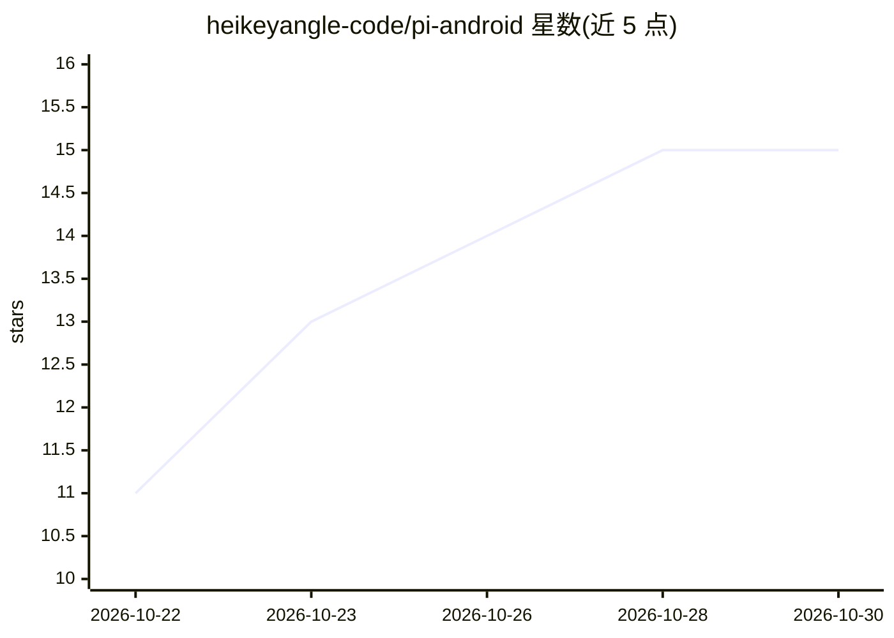

# heikeyangle-code/pi-android

⭐ 15 · Kotlin · 推送 2026-10-26 · [GitHub](https://github.com/heikeyangle-code/pi-android) · 个人维护 · 中文 README

**在安卓手机本地运行 pi coding agent 的应用，保留完整扩展生态**

一个安卓 App，将终端 coding agent pi 以官方 npm 包形式随 APK 分发，通过其 --mode rpc（JSONL over stdio）驱动，不 fork 或打补丁。App 内打包 Ubuntu 24.04 用户态、Node.js 24.19、git/ripgrep/fd 与 proot，无需 root 即可执行真实 Linux 工具。扩展机制与桌面端一致：扩展、技能、主题、提示词均为普通文件，可用自然语言让 agent 自行搜索、编写、安装。另附设备层扩展（默认关闭、逐项授权）可读屏、点按、读写文件。模型推理依赖用户自配服务或局域网 Ollama/llama.cpp/vLLM，App 不含模型权重。提供 arm64 APK（Android 8.0+），无商店版本，需从 release 或 CI 产物获取。

## 筛选速览

| 维度 | 判定 | 备注 |
|---|---|---|
| AI 角色 | `ai-native` | 本体是模型或模型工具 |
| 许可风险 | `none` | — |
| 部署形态 | `None` |  |
| 模型依赖 | — | README 未给出锁定关系 |
| 硬件要求 | — | 无带数字的原话,不猜 |
| 安装摩擦 | `low` | 无编译、无系统依赖或容器化 |
| 成熟度 | — | 结构信号不足 |

## 能力要点

- 以官方 pi 包 + RPC 模式驱动引擎，扩展生态与桌面端一致
- APK 内置 Ubuntu 用户态 + Node.js + proot，无需 root、不依赖 Termux
- 13 条 provider 预设；模型请求发往用户自配服务或局域网运行时
- 设备能力（读屏/点按/文件等 30 个端点）默认全关、按类授权

## 适用场景

- 在安卓手机上运行与桌面一致的 pi coding agent 及其扩展
- 通过自然语言让 agent 自行安装、编写扩展与技能
- 让 agent 在授权范围内读写本机文件、操作手机界面

## 场景标签

`编码 Agent` `GUI 自动化` · 领域:效率与自动化

## 证据(README 行号)

> L23: 一个安卓 App，把 pi 跑在手机本地。
> L25: pi 是终端里的 coding agent。它的能力几乎全部来自**可扩展性**——而这个 App 的第一件事，
> L152: - **不做离线推理。** 本地执行不等于本地模型——要么连你自己的服务，要么用局域网里的 Ollama / llama.cpp / vLLM。App 不含任何模型权重。

## 星数曲线

2026-10-22 11 → 2026-10-30 15（+4）

---
*卡片 v1 · prompt 1.4 · 生成 2026-10-30 · 置信度 high · 依据 README sha `c86789132ea3` · [字段定义](../../DATASET.md)*
