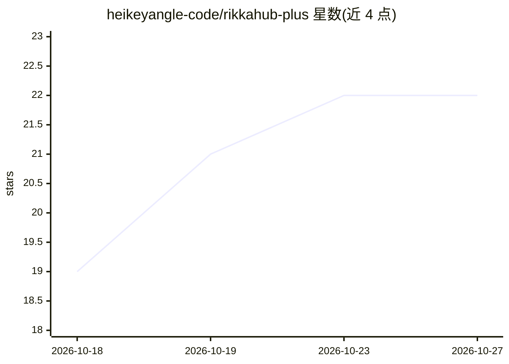

# heikeyangle-code/rikkahub-plus

⭐ 22 · Kotlin · AGPL-3.0 · 推送 2026-08-13 · [GitHub](https://github.com/heikeyangle-code/rikkahub-plus) · 个人维护 · 中文 README

**给 AI 角色扮演与命理爱好者的 Android 聊天客户端定制分支**

基于开源 Android LLM 聊天客户端 RikkaHub 的深度定制分支（Kotlin + Jetpack Compose），保留上游多提供商、流式输出、MCP 等全部功能，新增 SillyTavern 角色卡/世界书兼容层（22 字段无损导入导出、30+ 字段世界书条目、宏引擎 2.0、21 个斜杠命令、群聊）与十二套确定性命理排盘体系（八字/紫微/西洋占星/吠陀等，Python/JS 双引擎桥接），AI 按 14 份模板逐条解读排盘结果。面向在手机上做 AI 角色扮演与命理解读的终端用户。

## 筛选速览

| 维度 | 判定 | 备注 |
|---|---|---|
| AI 角色 | `ai-native` | 本体是模型或模型工具 |
| 许可风险 | `viral` | AGPL-3.0 |
| 部署形态 | `None` |  |
| 模型依赖 | locked-api |  |
| 硬件要求 | — | 无带数字的原话,不猜 |
| 安装摩擦 | `low` | 无编译、无系统依赖或容器化 |
| 成熟度 | — | 结构信号不足 |

## 能力要点

- SillyTavern 角色卡 22 字段无损导入导出与世界书官方语义兼容（递归扫描、粘性/冷却、token 预算）
- 十二套命理排盘引擎，Python/JS 双引擎桥接与交叉验证，统一 JSON 输出
- 宏引擎 2.0 变量/条件/随机宏与 21 个斜杠命令
- 技能自动触发、GitHub 一键安装与批量下载更新检测

## 适用场景

- 在手机上导入 SillyTavern 角色卡与世界书进行 AI 角色扮演
- 用 AI 按权威模板解读八字、紫微、占星等排盘结果
- 多角色群聊对话与提示词编程（变量、条件宏）
- 通过 GitHub 链接安装和管理技能

## 场景标签

`聊天机器人` · 领域:对话与助手

## 证据(README 行号)

> L11: 一个跑在手机上的 AI 聊天客户端（Kotlin + Jetpack Compose + Material You）：
> L13: - **多提供商**：OpenAI / Claude / Gemini / DeepSeek 等任意 OpenAI、Anthropic、Google 兼容 API
> L15: - **命理系统**：十二套确定性排盘引擎（八字 / 紫微 / 塔罗 / 西洋占星 / 吠陀 / 奇门 / 六爻…），AI 按权威模板逐条解读

## 星数曲线

2026-10-18 19 → 2026-10-27 22（+3）

---
*卡片 v1 · prompt 1.4 · 生成 2026-10-27 · 置信度 high · 依据 README sha `b9c48b0f3b98` · [字段定义](../../DATASET.md)*
