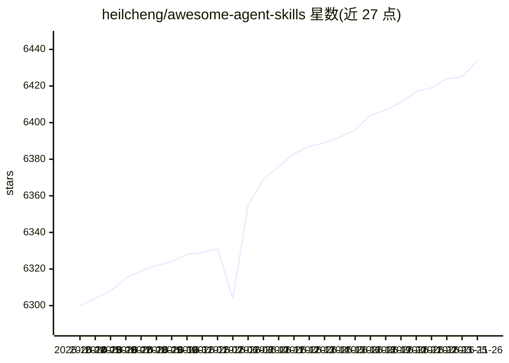

# heilcheng/awesome-agent-skills

⭐ 6,434 · TypeScript · MIT · 推送 2026-11-24 · [GitHub](https://github.com/heilcheng/awesome-agent-skills) · [官网](http://agent-skill.co) · 个人维护 · 中文 README

**面向 AI 用户的 agent skills 策展目录与使用教程**

社区维护的 Agent Skills 索引：收集各官方团队（Anthropic、OpenAI、Google、Hugging Face、Cloudflare、Vercel 等）发布的 SKILL.md 技能条目，按平台与领域分类组织。README 解释 skill 的三段加载机制（浏览/加载/使用），给出把技能载入 Claude Code、Claude.ai、Codex、Copilot、Autohand Code 的操作步骤，并推荐 SkillsMP、skills.sh、npx skills CLI 等发现与管理工具。强调收录真实工程团队实际使用的技能，不收录批量生成仓库。

## 筛选速览

| 维度 | 判定 | 备注 |
|---|---|---|
| AI 角色 | `ai-knowledge` | 知识聚合/清单类 |
| 许可风险 | `permissive` | MIT |
| 部署形态 | `self-host` | docker 或自建部署 |
| 模型依赖 | — | README 未给出锁定关系 |
| 硬件要求 | — | 无带数字的原话,不猜 |
| 安装摩擦 | `low` | 无编译、无系统依赖或容器化 |
| 成熟度 | — | 结构信号不足 |

## 能力要点

- 分类收录多家官方团队的 SKILL.md 技能条目
- 提供多平台技能载入步骤（Claude Code /skills add、Autohand 等）
- 介绍 npx skills CLI 的查找、安装、更新、卸载命令
- 提供 agent-skill.co 在线目录浏览

## 适用场景

- 为 Claude Code/Codex 等 agent 查找可用技能
- 按平台浏览官方技能目录
- 用 CLI 工具安装和管理技能文件

## 场景标签

`精选清单` · 领域:学习与行业

## 证据(README 行号)

> L11: Never heard of "agent skills" before? You're in the right place. This is a community-curated list of simple text fi
> L33: Skills are simple text files (called `SKILL.md`) that teach an AI how to do specific tasks. When you ask the AI to 
> L93: ## Official Skill Directories

## 星数曲线

2026-10-24 6,300 → 2026-11-26 6,434（+134）

---
*卡片 v1 · prompt 1.4 · 生成 2026-11-26 · 置信度 mid · 依据 README sha `28dd64e2cef9` · [字段定义](../../DATASET.md)*
