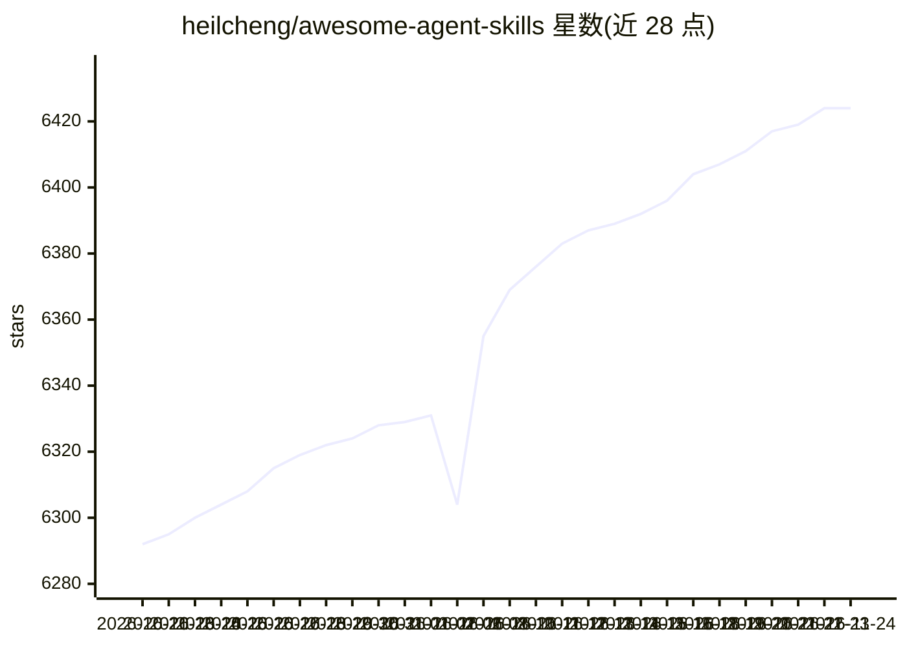

# heilcheng/awesome-agent-skills

⭐ 6,424 · TypeScript · MIT · 推送 2026-11-19 · [GitHub](https://github.com/heilcheng/awesome-agent-skills) · [官网](http://agent-skill.co) · 个人维护

**面向 AI agent 使用者的 SKILL.md 技能目录与教程清单**

社区策展的 Agent Skills 目录：收录 Anthropic、OpenAI、Google、Cloudflare、Vercel、HashiCorp 等团队实际使用的 SKILL.md 技能条目，按 AI 平台、云基础设施、开发者工具分类组织，并提供 agent-skill.co 在线浏览站点。README 介绍技能的三阶段加载机制（浏览/加载/使用），说明在 Claude Code、Codex 等兼容工具中的加载方法，并推荐 SkillsMP 市场与 npx skills CLI 用于发现和管理技能。由个人（Hailey Cheng）维护，提供多语言版本页面。

## 筛选速览

| 维度 | 判定 | 备注 |
|---|---|---|
| AI 角色 | `ai-knowledge` | 知识聚合/清单类 |
| 许可风险 | `permissive` | MIT |
| 部署形态 | `library` | 以包/库形式分发 |
| 模型依赖 | — | README 未给出锁定关系 |
| 硬件要求 | — | 无带数字的原话,不猜 |
| 安装摩擦 | `medium` | 含编译或系统依赖之一 |
| 成熟度 | — | 结构信号不足 |

## 能力要点

- 收录 Anthropic、OpenAI、Google、Hugging Face 等官方技能目录并分类组织
- 介绍 SKILL.md 的 Browse→Load→Use 三阶段加载机制
- 提供 npx skills CLI 的查找/安装/更新/卸载命令
- 支持 Claude Code、Codex、Gemini CLI、Cursor 等多种兼容 agent

## 适用场景

- 为 Claude Code 或 Codex 查找可直接加载的现成技能
- 了解各平台官方技能目录的覆盖范围
- 用 npx skills CLI 管理已安装的技能

## 场景标签

`精选清单` · 领域:学习与行业

## 证据(README 行号)

> L11: Never heard of "agent skills" before? You're in the right place. This is a community-curated list of simple text fi
> L93: ## Official Skill Directories
> L95: ### AI Platforms & Models

## 星数曲线

2026-10-21 6,292 → 2026-11-24 6,424（+132）

---
*卡片 v1 · prompt 1.4 · 生成 2026-11-22 · 置信度 mid · 依据 README sha `9bbaf83bb432` · [字段定义](../../DATASET.md)*
