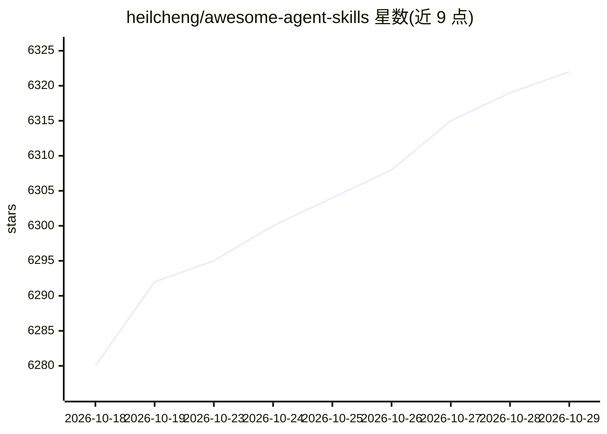

# heilcheng/awesome-agent-skills

⭐ 6,322 · TypeScript · MIT · 推送 2026-10-27 · [GitHub](https://github.com/heilcheng/awesome-agent-skills) · [官网](http://agent-skill.co) · 个人维护 · 中文 README

**社区策展的 AI agent 技能清单：教你为 Claude/Copilot 等加载技能**

社区维护的 Agent Skills 目录：收录由实际工程团队创建和使用的 SKILL.md 格式技能（教 AI 助手按需学习新能力的纯文本指令文件），按发布方组织，涵盖 Anthropic、OpenAI、Google Gemini、Hugging Face、Cloudflare、Netlify、Vercel、HashiCorp 等官方技能仓库。提供 30 秒上手流程（选技能→加载到 agent→对话调用），推荐 SkillsMP Marketplace、skills.sh 排行榜与 npx skills CLI 三种发现方式。由个人维护者 Hailey Cheng 运营，另提供 agent-skill.co 在线目录，README 提供含简体中文在内的多语言版本。

## 筛选速览

| 维度 | 判定 | 备注 |
|---|---|---|
| AI 角色 | `ai-knowledge` | 知识聚合/清单类 |
| 许可风险 | `permissive` | MIT |
| 部署形态 | `library` | 以包/库形式分发 |
| 模型依赖 | — | README 未给出锁定关系 |
| 硬件要求 | — | 无带数字的原话,不猜 |
| 安装摩擦 | `medium` | 含编译或系统依赖之一 |
| 成熟度 | — | 结构信号不足 |

## 能力要点

- 收录各厂商官方 SKILL.md 技能仓库（Anthropic/OpenAI/Gemini/HF/Cloudflare 等）
- 聚焦真实工程团队创建使用的技能，声明区别于批量生成仓库
- 列出 10 个兼容 agent（Claude Code、Codex、Copilot、Cursor 等）
- 提供 npx skills CLI 与两个第三方市场作为发现渠道

## 适用场景

- 为 Claude Code / Codex / Copilot 等 agent 查找可加载的技能
- 了解 Agent Skills 的概念与三阶段加载机制
- 浏览各厂商官方技能仓库覆盖的能力范围

## 场景标签

`精选清单` `提示工程` · 领域:Agent 开发

## 证据(README 行号)

> L11: Never heard of "agent skills" before? You're in the right place. This is a community-curated list of simple text fi
> L97: #### Skills by Anthropic

## 星数曲线

2026-10-18 6,280 → 2026-10-29 6,322（+42）

---
*卡片 v1 · prompt 1.4 · 生成 2026-10-20 · 置信度 mid · 依据 README sha `10cefcd3d637` · [字段定义](../../DATASET.md)*
