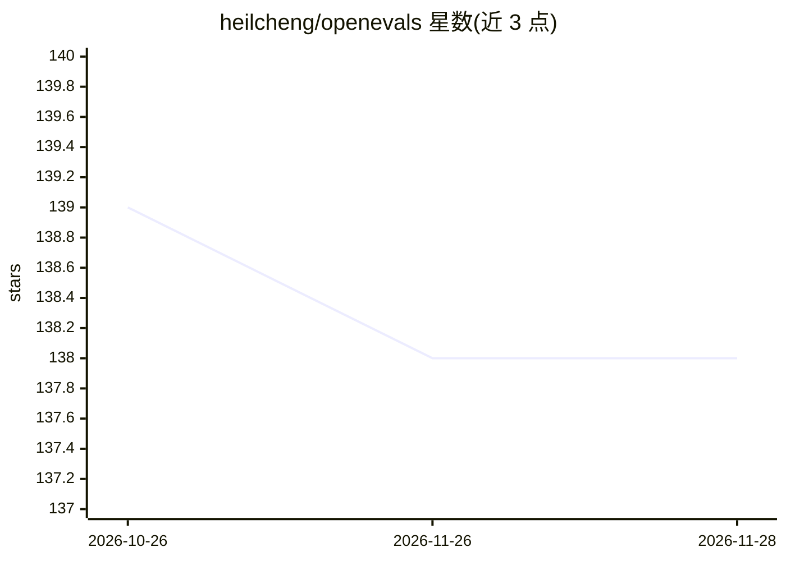

# heilcheng/openevals

⭐ 138 · Rust · MIT · 推送 2026-11-24 · [GitHub](https://github.com/heilcheng/openevals) · [官网](http://haileycheng.com/openevals/) · 个人维护

**给开发者在任意 OpenAI 兼容服务上评测开源权重 LLM 的 Rust 基准套件**

以 Rust 编写的开源权重语言模型基准测试套件：向任意暴露 /v1/chat/completions 的服务端（vLLM、SGLang、llama.cpp、Ollama、TGI、托管 API）发送基准提示，确定性评分并写入可续跑、可复现的结果。内置 MMLU-Pro、GPQA、MATH-500、HumanEval、效率等基准，附 68 个开源模型的注册表（参数量、上下文长度、许可证、推理模式）。需 Rust 1.88+，HumanEval 另需 PATH 中的 python3；数据集下载一次后可离线使用。

## 筛选速览

| 维度 | 判定 | 备注 |
|---|---|---|
| AI 角色 | `ai-ecosystem` | LLM/agent 周边工具 |
| 许可风险 | `permissive` | MIT |
| 部署形态 | `self-host` | docker 或自建部署 |
| 模型依赖 | local-ok | 支持本地模型 |
| 硬件要求 | — | 无带数字的原话,不猜 |
| 安装摩擦 | `low` | 无编译、无系统依赖或容器化 |
| 成熟度 | — | 结构信号不足 |

## 能力要点

- 单一 HTTP 后端对接所有 /v1/chat/completions 服务栈
- JSONL 完成缓存支持中断续跑与已完赛重评分零请求
- 确定性评分：固定 few-shot、种子洗牌、无模型参与打分
- models.toml 注册表含 68 个经 Hugging Face Hub API 核验的开源模型

## 适用场景

- 在不同推理服务栈上对开源模型跑标准化基准并生成排行榜
- 对比候选开源模型的准确率与吞吐/延迟效率指标
- 复现他人结果：缓存机制保证重跑与重评分不重复请求

## 场景标签

`模型评测` · 领域:评测与运维

## 证据(README 行号)

> L3: Benchmarking suite for open-weight language models, written in Rust. It sends benchmark prompts to any OpenAI-compat
> L13: - Benchmarks: MMLU, MMLU-Pro, GPQA, ARC, TruthfulQA (generation and MC1), GSM8K, MATH-500, HumanEval, and an effici

## 星数曲线

2026-10-26 139 → 2026-11-28 138（-1）

---
*卡片 v1 · prompt 1.4 · 生成 2026-11-27 · 置信度 high · 依据 README sha `80748fec5ab9` · [字段定义](../../DATASET.md)*
