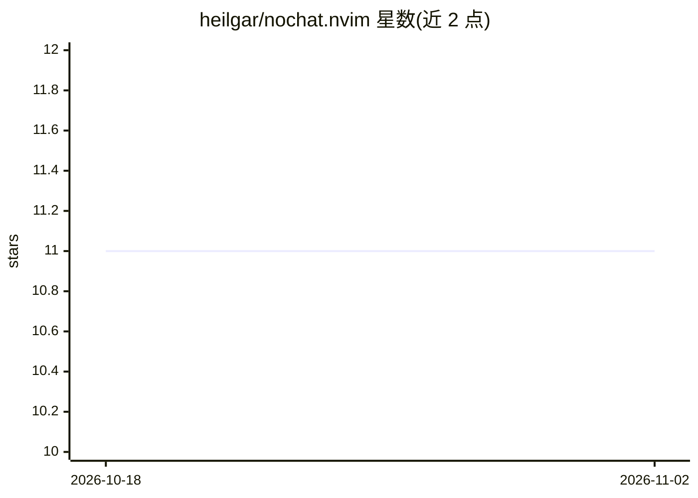

# heilgar/nochat.nvim

⭐ 11 · Lua · NOASSERTION · 推送 2026-09-11 · [GitHub](https://github.com/heilgar/nochat.nvim) · 个人维护

**Neovim 内的多模型 AI 聊天插件，支持多家提供商**

面向开发者的 Neovim 聊天插件：在编辑器内提供悬浮/分屏/标签页窗口的交互式对话界面，支持 Anthropic (Claude)、OpenAI (ChatGPT)、Ollama 本地模型三类提供商，通过 Telescope 选择提供商与模型，可在同一会话中切换多模型。支持将选中文本导出到聊天、光标感知交互、自定义快捷键与全局变量配置，并提供添加新提供商的 API。要求 Neovim 0.8+ 及 Telescope.nvim、plenary.nvim 依赖。

## 筛选速览

| 维度 | 判定 | 备注 |
|---|---|---|
| AI 角色 | `ai-ecosystem` | LLM/agent 周边工具 |
| 许可风险 | `none` | NOASSERTION |
| 部署形态 | `None` |  |
| 模型依赖 | local-ok | 支持本地模型 |
| 硬件要求 | — | 无带数字的原话,不猜 |
| 安装摩擦 | `low` | 无编译、无系统依赖或容器化 |
| 成熟度 | — | 结构信号不足 |

## 能力要点

- 支持 Anthropic / OpenAI / Ollama 三类提供商
- Telescope 选择提供商与模型，支持多模型聊天
- 窗口位置可配置（悬浮/分屏/标签页）并支持运行时切换
- 选中文本导出到聊天与光标感知交互

## 适用场景

- 在 Neovim 内不离开编辑器与 AI 对话、生成代码
- 将编辑器中选中的代码片段发给 AI 讨论
- 切换本地 Ollama 模型与云端模型进行对比对话

## 场景标签

`聊天机器人` · 领域:对话与助手

## 证据(README 行号)

> L15: - 🤖 Support for multiple AI providers:
> L19: - 🔍 Easy provider and model selection via Telescope

## 星数曲线

2026-10-18 11 → 2026-11-02 11（+0）

---
*卡片 v1 · prompt 1.4 · 生成 2026-11-02 · 置信度 high · 依据 README sha `cd48689d43b3` · [字段定义](../../DATASET.md)*
