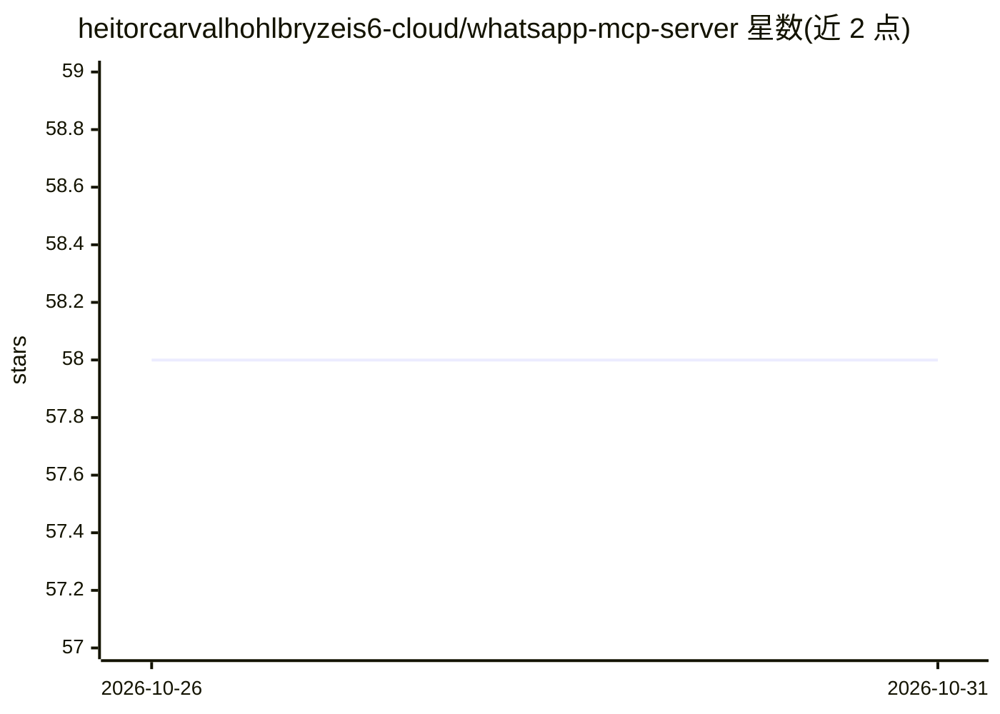

# heitorcarvalhohlbryzeis6-cloud/whatsapp-mcp-server

⭐ 58 · HTML · 推送 2026-10-30 · [GitHub](https://github.com/heitorcarvalhohlbryzeis6-cloud/whatsapp-mcp-server) · 个人维护

**把 WhatsApp 接入 MCP 的服务器：让 AI agent 操作 WhatsApp**

TypeScript 编写的 WhatsApp MCP 服务器，作为 AI agent 与 WhatsApp 之间的中间层，通过 Streamable HTTP 与 stdio 两种 MCP 传输暴露 61 个工具、10 个资源和 12 个实时事件，连接时自动发现。支持 Baileys（WhatsApp Web，QR/配对码）与 Meta Cloud API 双后端，同一套 wa_* 工具接口可切换后端。出站消息经 BullMQ 队列与 Redis 限速，会话与消息持久化到 SQLite，支持单进程多实例、自动重连、工具白名单/黑名单，音频转写与 TTS 为可选配置项。面向在 Claude、LangChain、Google ADK 等 MCP 兼容框架中接入 WhatsApp 的开发者，提供 Docker 部署方式。

## 筛选速览

| 维度 | 判定 | 备注 |
|---|---|---|
| AI 角色 | `ai-ecosystem` | LLM/agent 周边工具 |
| 许可风险 | `none` | — |
| 部署形态 | `None` |  |
| 模型依赖 | — | README 未给出锁定关系 |
| 硬件要求 | — | 无带数字的原话,不猜 |
| 安装摩擦 | `low` | 无编译、无系统依赖或容器化 |
| 成熟度 | — | 结构信号不足 |

## 能力要点

- 61 个 MCP 工具 + 10 个资源 + 12 个实时事件，连接时自动发现
- Baileys 与 Meta Cloud API 双后端共用同一 wa_* 工具接口
- BullMQ/Redis 出站队列限速（Baileys 20/分钟、Cloud API 80/分钟）
- 单进程托管多 WhatsApp 实例，会话与消息持久化到 SQLite

## 适用场景

- 让 Claude 等 MCP 客户端直接读写 WhatsApp 消息、群组与联系人
- 构建 WhatsApp 自动化 agent 而不编写 REST 封装与 webhook 解析
- 同一 agent 代码在 WhatsApp Web 与 Meta Cloud API 之间切换部署

## 场景标签

`Agent 框架` · 领域:Agent 开发

## 证据(README 行号)

> L7: wamcp is a WhatsApp MCP server that connects AI agents to WhatsApp through the Model Context Protocol, exposing 61 t
> L29: Agent  ──MCP (Streamable HTTP | stdio)──▶  wamcp  ──▶  Baileys / Cloud API  ──▶  WhatsApp
> L55: `wamcp` sits between your AI agent and WhatsApp as a single MCP endpoint. Your agent speaks the Model Context Proto

## 星数曲线

2026-10-26 58 → 2026-10-31 58（+0）

---
*卡片 v1 · prompt 1.4 · 生成 2026-10-27 · 置信度 high · 依据 README sha `5c7a1bd317e8` · [字段定义](../../DATASET.md)*
