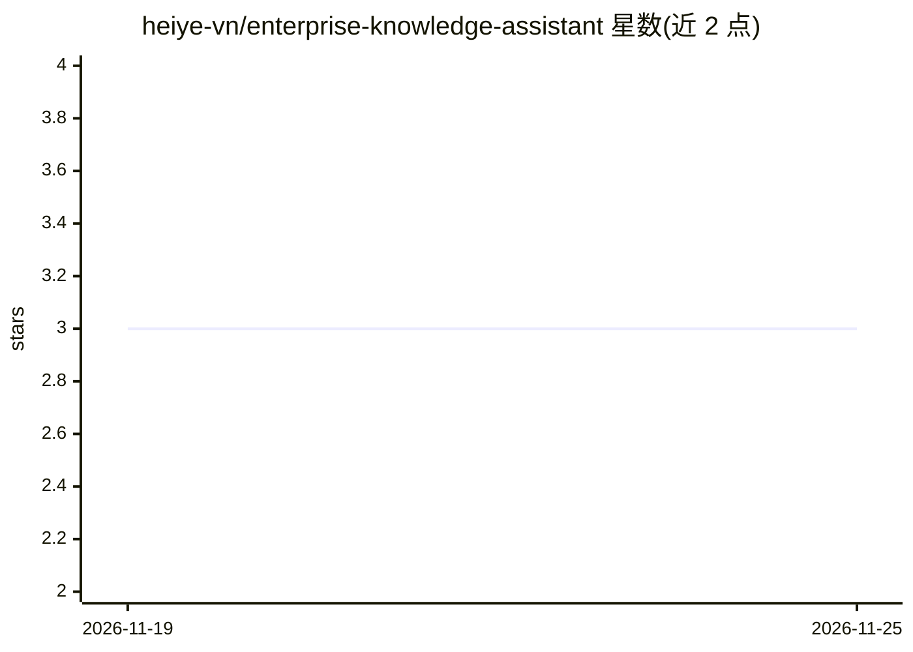

# heiye-vn/enterprise-knowledge-assistant

⭐ 3 · Python · 推送 2026-11-20 · [GitHub](https://github.com/heiye-vn/enterprise-knowledge-assistant) · 个人维护 · 中文 README

**企业制度文档 RAG 问答系统：上传文档、溯源回答、拒答无据问题**

基于 RAG 与知识图谱的企业知识库应用：上传 PDF/Word/Markdown/制度图片后入库（MinerU 解析、切块、pgvector 向量索引），问答走 BM25+向量混合检索、RRF 融合与重排，回答带引用可定位原文与检索分数，无依据时明确拒答。另提供异步抽取的知识图谱（Neo4j）、Tavily 联网查询与 LangSmith 链路追踪（均为可选项）。前端面向电脑端，部署需要 Docker Compose 运行六个基础设施容器加本机 API 与前端终端。

## 筛选速览

| 维度 | 判定 | 备注 |
|---|---|---|
| AI 角色 | `ai-native` | 本体是模型或模型工具 |
| 许可风险 | `none` | — |
| 部署形态 | `desktop` | 安装包/桌面程序 |
| 模型依赖 | — | README 未给出锁定关系 |
| 硬件要求 | — | 无带数字的原话,不猜 |
| 安装摩擦 | `low` | 无编译、无系统依赖或容器化 |
| 成熟度 | — | 结构信号不足 |

## 能力要点

- BM25 + pgvector 混合检索，RRF 融合与 Rerank 重排，公开真实检索分数
- 引用溯源：点击定位原文或切块，无依据拒答，答案经引用校验后发布
- 从原文异步抽取规则/角色/材料关系写入 Neo4j，支持两跳证据扩展
- SHA-256 全库指纹去重，支持 PNG/JPG 图片 OCR 入库

## 适用场景

- 上传企业制度文档后用自然语言提问并核对原文条款
- 查阅跨文档证据路径与知识图谱关系来源
- 在无依据时获得明确拒答而非编造回答

## 场景标签

`RAG` `文档问答` `知识图谱` · 领域:知识与检索

## 证据(README 行号)

> L3: 基于 RAG 与知识图谱的企业知识库应用。上传制度文档后，可以用自然语言提问、核对原文、查看检索分数和跨文档证据路径；通用问题直接由模型回答，企业制度缺少依据时明确拒答。
> L17: |混合检索|BM25 关键词召回 + pgvector 向量召回，经 RRF 融合、Rerank 重排后提供回答证据|
> L85: |模型调用|HTTPX、千问 / OpenAI 兼容接口|向量化、重排、意图识别、生成与真实模型流|

## 星数曲线

2026-11-19 3 → 2026-11-25 3（+0）

---
*卡片 v1 · prompt 1.4 · 生成 2026-11-21 · 置信度 mid · 依据 README sha `f7fcc3d2f9ea` · [字段定义](../../DATASET.md)*
