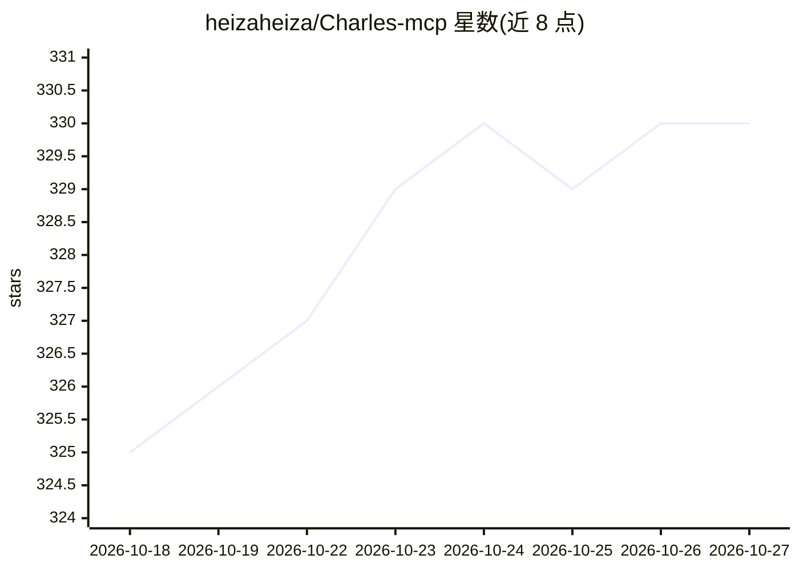

# heizaheiza/Charles-mcp

⭐ 330 · Python · MIT · 推送 2026-06-23 · [GitHub](https://github.com/heizaheiza/Charles-mcp) · [官网](https://pypi.org/project/charles-mcp/) · 个人维护 · 中文 README

**把 Charles Proxy 抓包接入 MCP 客户端的流量分析服务器**

面向 AI agent 的 Charles Proxy MCP server：通过 Charles Web Interface 读取实时流量与历史录包，提供 summary-first 的结构化分析工具链（31 个 canonical 工具），先聚合热点再 drill-down 单条请求，输出针对 token 预算做了瘦身。v3.0 起新增 reverse-analysis 工具面，覆盖会话导入、protobuf 解码、请求回放、签名字段候选发现与 live 逆向分析（登录流/API 流/签名流打分）。以 uvx 从 PyPI 运行，需本机已启动 Charles 并开启 Web Interface；默认不做数据脱敏，由上层客户端处理。

## 筛选速览

| 维度 | 判定 | 备注 |
|---|---|---|
| AI 角色 | `ai-ecosystem` | LLM/agent 周边工具 |
| 许可风险 | `permissive` | MIT |
| 部署形态 | `library` | 以包/库形式分发 |
| 模型依赖 | — | README 未给出锁定关系 |
| 硬件要求 | — | 无带数字的原话,不猜 |
| 安装摩擦 | `low` | 无编译、无系统依赖或容器化 |
| 成熟度 | — | 结构信号不足 |

## 能力要点

- 31 个 canonical 工具覆盖 live capture、历史分析、状态控制
- reverse-analysis：导入/解码/回放/签名候选发现/live 逆向工作流
- summary-first 输出与 token 预算优化（默认参数调低、剥离内部字段）
- 支持 Claude Code / Claude Desktop / Cursor / Codex 等 MCP 客户端配置

## 适用场景

- 让 agent 在抓包进行中持续读取并分析实时流量
- 分析历史 .chlsj 录包，定位热点 host/path 与错误流量
- 对已导入请求做回放与签名字段定位，支撑接口逆向分析

## 场景标签

 · 领域:网络调试/开发者工具

## 证据(README 行号)

> L12: Charles MCP Server 用于把 Charles Proxy 接入 MCP 客户端，让 agent 可以稳定地读取实时流量、分析历史录包，并在需要时再展开单条请求细节。
> L24: - 在保留原有 live/history 分析能力的基础上，新增 reverse-analysis 工具链（导入、查询、解码、回放、签名候选分析、live 逆向会话）。

## 星数曲线

2026-10-18 325 → 2026-10-27 330（+5）

---
*卡片 v1 · prompt 1.4 · 生成 2026-10-21 · 置信度 high · 依据 README sha `3605a2194057` · [字段定义](../../DATASET.md)*
