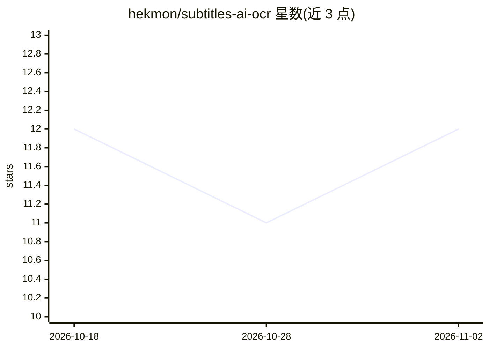

# hekmon/subtitles-ai-ocr

⭐ 12 · Go · MIT · 推送 2026-07-24 · [GitHub](https://github.com/hekmon/subtitles-ai-ocr) · 个人维护

**用视觉语言模型把 PGS/VobSub 图形字幕转成 SRT 文本的工具**

读取蓝光 PGS 与 DVD VobSub 图形字幕，将字幕图像发送到 OpenAI API 兼容的视觉语言模型（OpenAI 云端、Ollama 自托管或 vLLM 高性能部署均可）识别文字，生成 SRT 文件。命令行工具，支持 -debug 逐条校验、-batch 批量模式降低费用、-workers 并发与自定义输出路径；README 建议用 Subtitle Edit 复查结果。基于 go-pgs-parser 库构建，以预编译二进制方式运行。

## 筛选速览

| 维度 | 判定 | 备注 |
|---|---|---|
| AI 角色 | `ai-native` | 本体是模型或模型工具 |
| 许可风险 | `permissive` | MIT |
| 部署形态 | `desktop` | 安装包/桌面程序 |
| 模型依赖 | local-ok | 支持本地模型 |
| 硬件要求 | — | 无带数字的原话,不猜 |
| 安装摩擦 | `low` | 无编译、无系统依赖或容器化 |
| 成熟度 | — | 结构信号不足 |

## 能力要点

- 解码 PGS/VobSub 图形字幕并通过视觉语言模型提取文本
- 兼容任意 OpenAI API 端点（OpenAI / Ollama / vLLM）
- -batch 批量模式与 -workers 并发参数，可整季批量处理

## 适用场景

- 把蓝光/DVD 图形字幕转成可编辑的 SRT 文本字幕
- 本地 Ollama/Qwen3-VL 离线完成字幕 OCR
- 批量处理整季视频字幕文件

## 场景标签

`OCR` · 领域:感知与多模态

## 证据(README 行号)

> L3: Decode Bluray PGS or DVD VobSub subtitles and extract their embedded text using a Vision Language Model (OpenAI API 
> L75: This example will use Ollama but you can use any self hosted inference server as long as it has an OpenAI API compa

## 星数曲线

2026-10-18 12 → 2026-11-02 12（+0）

---
*卡片 v1 · prompt 1.4 · 生成 2026-11-02 · 置信度 high · 依据 README sha `e63557ab2029` · [字段定义](../../DATASET.md)*
