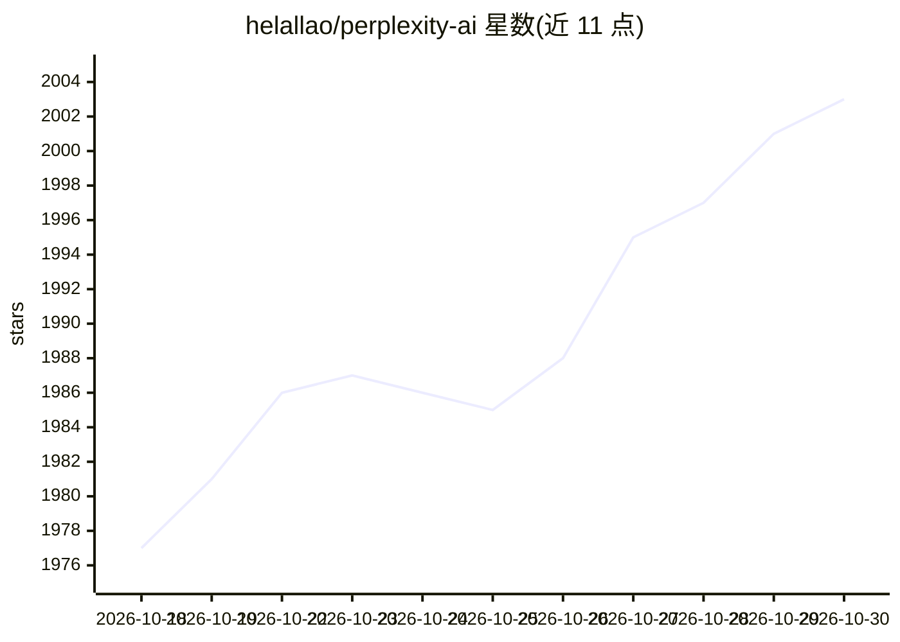

# helallao/perplexity-ai

⭐ 2,003 · Python · MIT · 推送 2026-10-08 · [GitHub](https://github.com/helallao/perplexity-ai) · [官网](https://perplexity.ai) · 个人维护

**非官方 Perplexity.ai Python 封装：逆向网页接口免 API key 使用**

通过逆向 Perplexity 网页接口访问其问答、深度研究、推理与搜索功能的 Python 库，无需付费 API key；支持同步/异步 API、流式输出、文件上传，并可借助 Emailnator 自动生成账号。另附 MCP 服务器，将 Perplexity 搜索以工具形式暴露给 Claude Code 等 MCP 客户端，支持 stdio 与 HTTP 传输，深度研究任务记录于本地 SQLite 日志（仅 POSIX）。Web 界面基于 Patchright 驱动 Chrome 自动化。不支持官方 MCP 的消息数组、结果过滤等参数。

## 筛选速览

| 维度 | 判定 | 备注 |
|---|---|---|
| AI 角色 | `ai-ecosystem` | LLM/agent 周边工具 |
| 许可风险 | `permissive` | MIT |
| 部署形态 | `library` | 以包/库形式分发 |
| 模型依赖 | — | README 未给出锁定关系 |
| 硬件要求 | — | 无带数字的原话,不猜 |
| 安装摩擦 | `low` | 无编译、无系统依赖或容器化 |
| 成熟度 | — | 结构信号不足 |

## 能力要点

- 逆向网页接口，无需 API key 即可使用 Perplexity 各模式
- MCP 服务器暴露 7 个工具（问答/研究/推理/搜索），支持 stdio 与 HTTP 传输
- 深度研究任务本地 SQLite 日志与后台执行，断连不取消（仅 POSIX）
- Emailnator 自动生成账号、同步/异步 API、流式输出与文件上传

## 适用场景

- 在 Python 项目中调用 Perplexity 问答与搜索而不购买官方 API
- 让 Claude Code 等 MCP 客户端把 Perplexity 作为搜索/研究工具
- 通过 Web 界面自动创建账号并使用查询

## 场景标签

 · 领域:LLM API 封装/搜索问答

## 证据(README 行号)

> L7: Perplexity AI is a Python module that leverages Emailnator to generate new accounts for unlimited pro queries. It su
> L64: This project includes an MCP (Model Context Protocol) server that exposes Perplexity search as tools for Claude Cod
> L196: ### Differences from the Official MCP

## 星数曲线

2026-10-18 1,977 → 2026-10-30 2,003（+26）

---
*卡片 v1 · prompt 1.4 · 生成 2026-10-21 · 置信度 high · 依据 README sha `677d2f258c39` · [字段定义](../../DATASET.md)*
