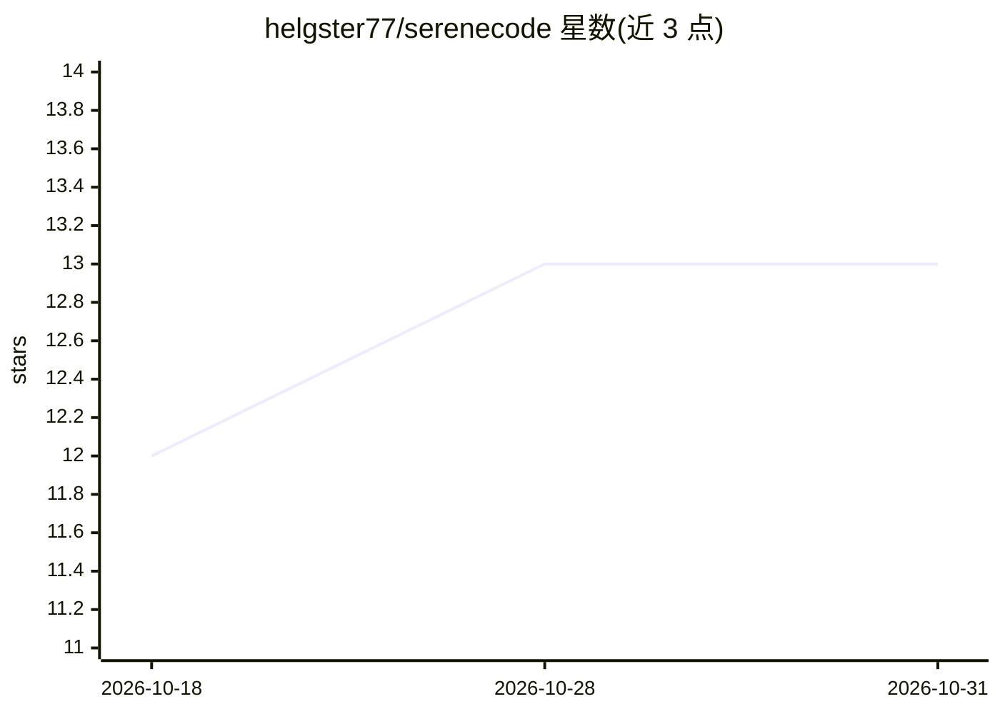

# helgster77/serenecode

⭐ 13 · Python · MIT · 推送 2026-10-15 · [GitHub](https://github.com/helgster77/serenecode) · [官网](https://pypi.org/project/serenecode) · 个人维护

**面向 AI 编码助手的可验证开发框架：规范+契约+六级校验流水线**

Python 工具包与工作流，供使用 AI 编码助手的团队约束与核验模型产出的代码：结构化规范（REQ-xxx/INT-xxx）、项目级 SERENECODE.md 编码约定、以 icontract 可执行契约表达输入约束，并通过 MCP 服务器（编辑中）或 CLI（CI/批量）驱动六级校验流水线：L1 AST 结构检查、L2 mypy --strict、L3 pytest 行/分支覆盖（默认 80%）、L4 Hypothesis 生成输入、L5 CrossHair/Z3 反例搜索（有预算限制）、L6 跨模块架构检查。输出定位到文件/行/符号的发现与建议修复。README 明确声明无对比基准、结果非正确性证明、非临床/监管认证。

## 筛选速览

| 维度 | 判定 | 备注 |
|---|---|---|
| AI 角色 | `ai-ecosystem` | LLM/agent 周边工具 |
| 许可风险 | `permissive` | MIT |
| 部署形态 | `library` | 以包/库形式分发 |
| 模型依赖 | — | README 未给出锁定关系 |
| 硬件要求 | — | 无带数字的原话,不猜 |
| 安装摩擦 | `low` | 无编译、无系统依赖或容器化 |
| 成熟度 | — | 结构信号不足 |

## 能力要点

- 六级递进校验流水线（AST/mypy/pytest/Hypothesis/CrossHair/架构分析）
- MCP 服务器将发现送入编辑循环，CLI 用于 CI 与全树批量运行
- 契约可执行性检查（如 icontract 对 *args 前置条件不生效的识别）
- Minimal/Default/Strict 三档预设控制规则与默认校验深度

## 适用场景

- 团队用 AI 助手写代码时核验产出是否符合规范与契约
- 在 CI 中运行全量校验流水线拦截不合格合并
- 为编辑器内的编码助手提供即时定位的检查反馈

## 场景标签

`代码审查` · 领域:编码与开发

## 证据(README 行号)

> L5: SereneCode turns the question from "did the model ship code?" to "does it match the spec, the types, and the contrac
> L42: 4. During editing, use the MCP file/function tools for focused findings. Choose L1–L2 for static feedback; executio

## 星数曲线

2026-10-18 12 → 2026-10-31 13（+1）

---
*卡片 v1 · prompt 1.4 · 生成 2026-10-31 · 置信度 mid · 依据 README sha `8a0a6a5b4f55` · [字段定义](../../DATASET.md)*
