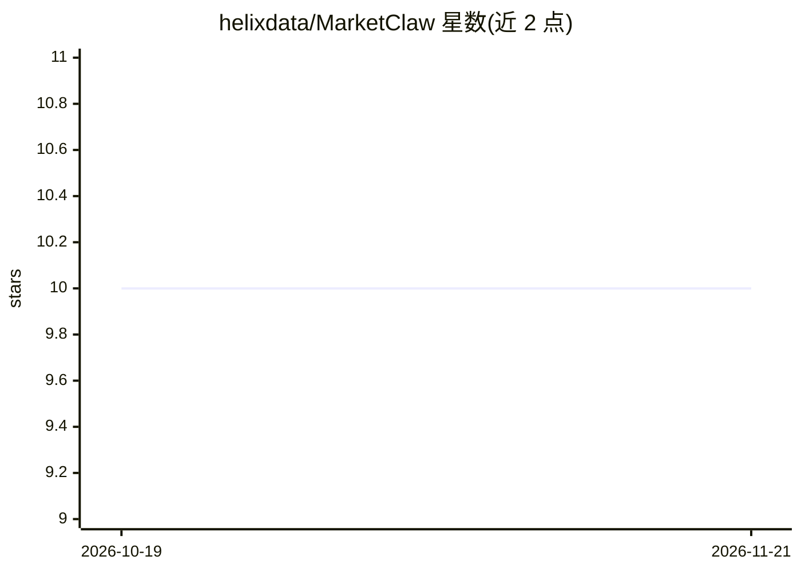

# helixdata/MarketClaw

⭐ 10 · TypeScript · MIT · 推送 2026-06-05 · [GitHub](https://github.com/helixdata/MarketClaw) · 组织维护

**聊天中的 AI 营销 agent：内容创作、活动与任务自动化**

以 TypeScript 编写的 AI 营销助手，运行于 Telegram、Discord、Slack 或 CLI 渠道，通过对话管理产品、创作推文/LinkedIn 帖、组织营销活动并追踪指标与 API 成本。内置持久化记忆（品牌声音、产品、活动历史）、7 个专项子 agent、多用户角色与内容审批流程；可经 Chrome 扩展模拟人工发帖至 10 个社交平台。提供 npm 全局安装与源码构建两种途径，默认使用 Anthropic 模型，可插拔更换 AI 提供商。

## 筛选速览

| 维度 | 判定 | 备注 |
|---|---|---|
| AI 角色 | `ai-native` | 本体是模型或模型工具 |
| 许可风险 | `permissive` | MIT |
| 部署形态 | `library` | 以包/库形式分发 |
| 模型依赖 | local-ok | 支持本地模型 |
| 硬件要求 | — | 无带数字的原话,不猜 |
| 安装摩擦 | `low` | 无编译、无系统依赖或容器化 |
| 成熟度 | — | 结构信号不足 |

## 能力要点

- 多渠道对话接入：Telegram、Discord、Slack、CLI
- 7 个专项子 agent 与多用户角色、审批工作流
- 浏览器自动化经 Chrome 扩展发帖至 10 个平台（无 API 调用费）
- 按工具/agent/产品维度的成本追踪与预算控制

## 适用场景

- 在 Telegram 里用对话安排和管理营销内容发布
- 团队协作起草、审批并发布社媒内容
- 追踪每个营销活动和工具的 API 花费

## 场景标签

`聊天机器人` `AI 写作` `浏览器自动化` · 领域:效率与自动化

## 证据(README 行号)

> L5:  AI-powered marketing agent that lives in your chat.
> L25: MarketClaw is an AI marketing assistant that:
> L96: - **Browser automation** — Post to 10 platforms via Chrome extension (no API costs!)

## 星数曲线

2026-10-19 10 → 2026-11-21 10（+0）

---
*卡片 v1 · prompt 1.4 · 生成 2026-11-19 · 置信度 high · 依据 README sha `fea060d67f42` · [字段定义](../../DATASET.md)*
