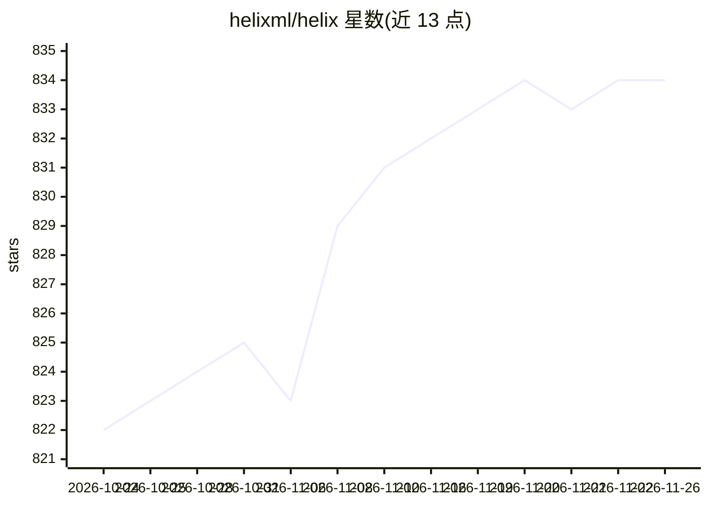

# helixml/helix

⭐ 834 · Go · NOASSERTION · 推送 2026-11-25 · [GitHub](https://github.com/helixml/helix) · [官网](https://helix.ml) · 组织维护

**私有部署的多 agent 编队平台：spec 驱动并行编码**

Helix 是一个可私有部署（含完全离线）的编码 agent 编队平台：用户以 spec 任务描述目标，planning agent 读仓库生成规格书并接受人工审批，实现 agent 在各自隔离的 GPU 加速桌面沙箱中编码并提交 PR，任务通过 Kanban 板协作流转。支持 Claude Code、Codex、Gemini CLI 等多种 agent harness 与自托管 vLLM 等模型后端，附带 RAG、MCP、可观测性、多租户 SSO 与计费模块。许可对个人/教育/小企业免费，大型商用需购买许可。

## 筛选速览

| 维度 | 判定 | 备注 |
|---|---|---|
| AI 角色 | `ai-ecosystem` | LLM/agent 周边工具 |
| 许可风险 | `none` | NOASSERTION |
| 部署形态 | `self-host` | docker 或自建部署 |
| 模型依赖 | local-ok | 支持本地模型 |
| 硬件要求 | — | 无带数字的原话,不猜 |
| 安装摩擦 | `low` | 无编译、无系统依赖或容器化 |
| 成熟度 | — | 结构信号不足 |

## 能力要点

- 每个 agent 独立 GPU 加速桌面沙箱，可实时观看与中途接管
- spec 任务流程：规划→审批→实现→PR→合并的 Kanban 流转
- 可挂接任意 OpenAI 兼容端点（含 vLLM），支持离线部署
- 附带 RAG、MCP 兼容、tracing、多租户 SSO 与计费模块

## 适用场景

- 团队并行派发多个编码任务并通过 PR 统一评审
- 在自己的 GPU/Kubernetes 上离线运行 agent 编队
- 按任务切换 agent harness 与模型以控制成本

## 场景标签

`编码 Agent` `多智能体` `RAG` `LLM 可观测性` · 领域:Agent 开发

## 证据(README 行号)

> L16: Helix runs those agents as a **fleet** — many in parallel, each in its own isolated sandbox with a full desktop (br
> L69: - **Self-hosted models** — attach any OpenAI-compatible endpoint as an external provider. This includes **vLLM**: p
> L107: ### Install on Kubernetes

## 星数曲线

2026-10-24 822 → 2026-11-26 834（+12）

---
*卡片 v1 · prompt 1.4 · 生成 2026-11-25 · 置信度 high · 依据 README sha `d5585ec3a15b` · [字段定义](../../DATASET.md)*
