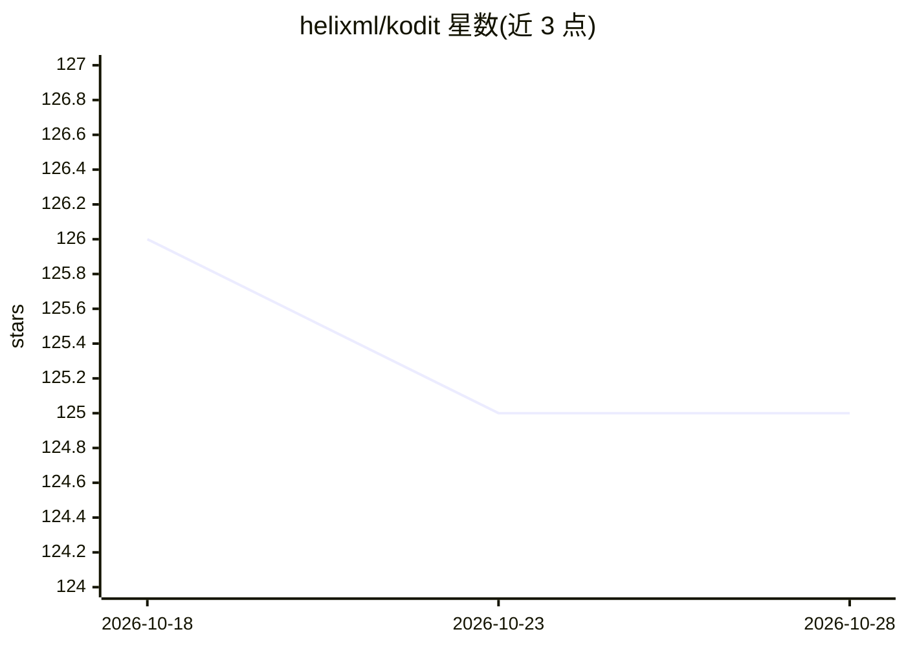

# helixml/kodit

⭐ 125 · Go · Apache-2.0 · 推送 2026-10-25 · [GitHub](https://github.com/helixml/kodit) · [官网](https://docs.helix.ml/kodit/) · 组织维护

**索引 Git 仓库与文档、供 AI 助手检索的 MCP/REST 服务器**

面向 AI 编码助手场景的代码与文档检索服务：索引 Git 仓库，把源文件切分为可检索片段，同时将 PDF、Office 文档栅格化后索引，通过 MCP 端点与 REST API 提供 BM25 关键词、语义向量、正则 grep、视觉文档四类搜索。基础运行无需外部依赖，内置嵌入模型与 SQLite 存储；可选配置 LLM 提供方生成架构文档、API 文档、数据库 schema 等 AI 增强内容。可经 Docker、预编译二进制部署，也可作为 Go 库嵌入，生产环境支持 PostgreSQL(VectorChord) 与 Kubernetes。

## 筛选速览

| 维度 | 判定 | 备注 |
|---|---|---|
| AI 角色 | `ai-ecosystem` | LLM/agent 周边工具 |
| 许可风险 | `permissive` | Apache-2.0 |
| 部署形态 | `desktop` | 安装包/桌面程序 |
| 模型依赖 | locked-api |  |
| 硬件要求 | — | 无带数字的原话,不猜 |
| 安装摩擦 | `low` | 无编译、无系统依赖或容器化 |
| 成熟度 | — | 结构信号不足 |

## 能力要点

- BM25/语义/正则/视觉四种搜索策略，各自独立暴露为 MCP 工具
- 基础运行无需外部依赖与 API key，内置嵌入模型与 SQLite
- 支持索引 PDF/Word/PPT/表格并做跨模态视觉搜索
- 可作为 Go 库嵌入，并提供 Docker Compose 与 Kubernetes 部署配置

## 适用场景

- 让 Claude Code/Cursor 等 MCP 助手在写代码前检索本仓库的真实示例
- 在同一处检索代码与项目文档（含 PDF/Office 文件）
- 为大型代码库生成架构文档、API 文档等 LLM 增强内容

## 场景标签

`语义搜索` `文档解析` · 领域:知识与检索

## 证据(README 行号)

> L5: A code and document intelligence server that indexes Git repositories and provides search through MCP and REST APIs.
> L17: - **MCP server** that works with Claude Code, Cursor, Cline, Kilo Code, and any other MCP-compatible assistant
> L57: Kodit exposes an MCP endpoint at `/mcp`. Connect your assistant to start using Kodit as a code search tool.

## 星数曲线

2026-10-18 126 → 2026-10-28 125（-1）

---
*卡片 v1 · prompt 1.4 · 生成 2026-10-23 · 置信度 high · 依据 README sha `1f6a3aae0aad` · [字段定义](../../DATASET.md)*
