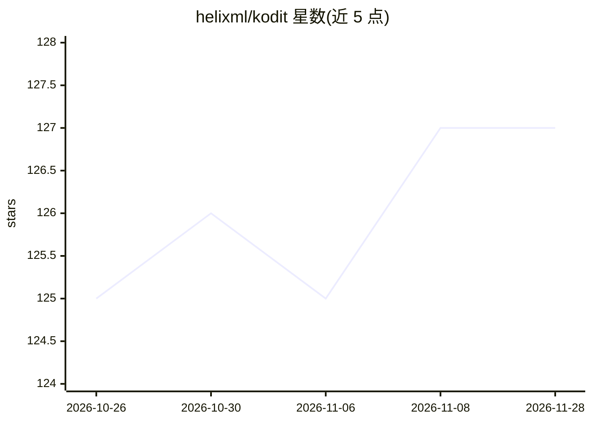

# helixml/kodit

⭐ 127 · Go · Apache-2.0 · 推送 2026-11-20 · [GitHub](https://github.com/helixml/kodit) · [官网](https://docs.helix.ml/kodit/) · 组织维护

**为 MCP 编码助手索引 Git 仓库并提供代码/文档搜索的服务器**

Kodit 是一个代码与文档索引服务器：克隆 Git 仓库、切分源码为可检索片段，通过 MCP 与 REST API 向 AI 编码助手提供搜索。内置 BM25 关键词、语义向量、正则 grep 与多模态文档视觉搜索四种策略，各自暴露为独立 MCP 工具；PDF/Office 文档经栅格化后可一并检索。基础运行无需外部依赖（内置嵌入模型与 SQLite），LLM 富化功能（架构/API 文档、schema 检测、示例、提交摘要）为可选，需配置 LLM 提供方。提供 Docker 镜像、预编译二进制与 Go 库嵌入方式。

## 筛选速览

| 维度 | 判定 | 备注 |
|---|---|---|
| AI 角色 | `ai-ecosystem` | LLM/agent 周边工具 |
| 许可风险 | `permissive` | Apache-2.0 |
| 部署形态 | `desktop` | 安装包/桌面程序 |
| 模型依赖 | — | README 未给出锁定关系 |
| 硬件要求 | — | 无带数字的原话,不猜 |
| 安装摩擦 | `low` | 无编译、无系统依赖或容器化 |
| 成熟度 | — | 结构信号不足 |

## 能力要点

- 四种搜索策略（BM25/语义向量/grep/文档视觉搜索）各自暴露为 MCP 工具
- 基础操作无外部依赖：内置嵌入模型与 SQLite 存储，无需 API key
- 可选 LLM 富化：架构文档、API 文档、数据库 schema、示例与提交摘要
- 支持 Docker、Kubernetes 部署与 Go 库嵌入，提供 OpenAPI 生成的 HTTP 客户端

## 适用场景

- 让 Claude Code/Cursor 等助手基于自己的代码库检索真实示例后再写代码
- 统一检索仓库代码与 PDF/Office 文档
- 为团队代码库生成架构/API 文档与用法示例
- 通过 REST API 程序化接入仓库索引与搜索

## 场景标签

`语义搜索` · 领域:知识与检索

## 证据(README 行号)

> L5: A code and document intelligence server that indexes Git repositories and provides search through MCP and REST APIs.
> L10: AI coding assistants work better when they have access to real examples from your codebase. Kodit indexes your repo
> L17: - **MCP server** that works with Claude Code, Cursor, Cline, Kilo Code, and any other MCP-compatible assistant

## 星数曲线

2026-10-26 125 → 2026-11-28 127（+2）

---
*卡片 v1 · prompt 1.4 · 生成 2026-11-28 · 置信度 high · 依据 README sha `dbf0affad75c` · [字段定义](../../DATASET.md)*
