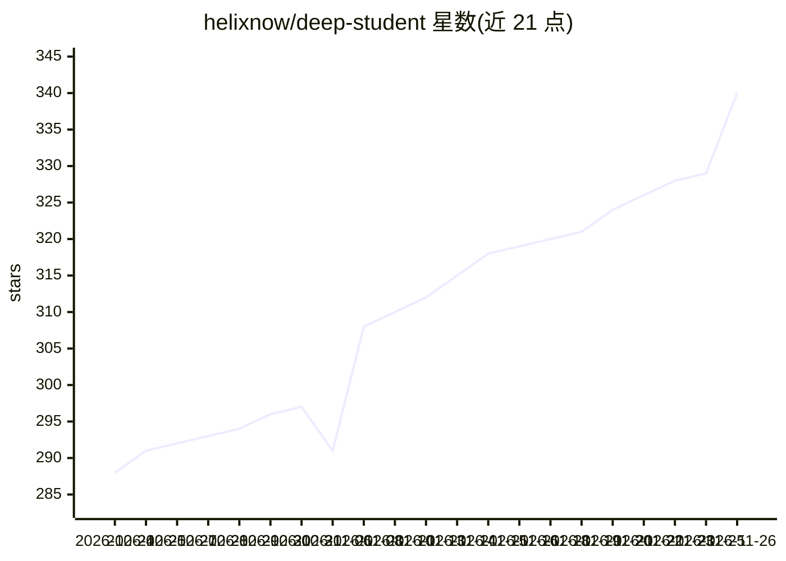

# helixnow/deep-student

⭐ 340 · TypeScript · AGPL-3.0 · 推送 2026-11-25 · [GitHub](https://github.com/helixnow/deep-student) · [官网](https://www.deepstudent.cn) · 个人维护 · 中文 README

**本地优先的 AI 学习工作台：Agent 代做笔记与复习**

面向学习者的桌面/移动端 AI 学习工作台，内置聊天、文件库、转录、PDF 阅读、笔记、思维导图、题集、抽认卡等应用；学习 Agent 通过专用工具在各应用中直接产出笔记、导图、题目、卡片、批改与复习计划。机制上采用 TypeScript 双内核插件架构（Cordis），内置 58 个技能、MCP 外部工具、15 个预设模型商、多搜索引擎与 OCR，支持风险分级审批、编辑撤销与 PDF 页级引用回链。数据本地存储（SQLite/LanceDB），支持 WebDAV/S3 同步与安全快照。

## 筛选速览

| 维度 | 判定 | 备注 |
|---|---|---|
| AI 角色 | `ai-native` | 本体是模型或模型工具 |
| 许可风险 | `viral` | AGPL-3.0 |
| 部署形态 | `desktop` | 安装包/桌面程序 |
| 模型依赖 | locked-api |  |
| 硬件要求 | — | 无带数字的原话,不猜 |
| 安装摩擦 | `medium` | 含编译或系统依赖之一 |
| 成熟度 | — | 结构信号不足 |

## 能力要点

- Agent 在各应用内直接落地产出：笔记、导图、题集、卡片、作文批改与翻译
- 58 个内置技能 + MCP 外接工具 + 15 个预设模型商与 9 个搜索引擎、6 个 OCR 引擎
- Flashcards 应用内置 FSRS-6 间隔重复、.apkg 导入导出与 AnkiConnect v6 同步
- 数据本地存储（SQLite/LanceDB），支持 WebDAV/S3 云与局域网同步及 pre_restore 安全快照

## 适用场景

- 导入课本与真题，自动生成抽认卡并按 FSRS 安排每日复习冲刺
- 把录播课程转成带时间戳的笔记，对照讲稿提问
- 一句话生成学科思维导图，背记模式隐藏关键节点填空

## 场景标签

`知识库管理` `文档问答` · 领域:知识与检索

## 证据(README 行号)

> L9: An open-source, local-first AI learning workbench.
> L41: Notes, mind maps, exam sets, flashcards, todos, essay review and translation all have agent tools, so results land 
> L36: ## A study agent that works in every app

## 星数曲线

2026-10-24 288 → 2026-11-26 340（+52）

---
*卡片 v1 · prompt 1.4 · 生成 2026-11-26 · 置信度 high · 依据 README sha `26e936756714` · [字段定义](../../DATASET.md)*
