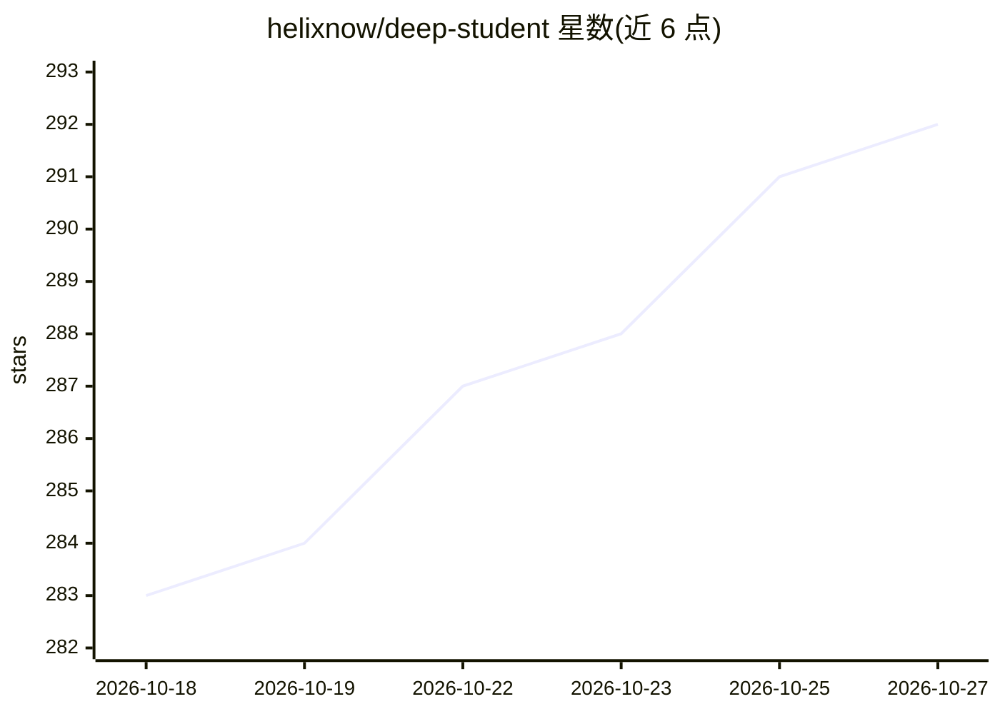

# helixnow/deep-student

⭐ 292 · TypeScript · AGPL-3.0 · 推送 2026-10-24 · [GitHub](https://github.com/helixnow/deep-student) · [官网](https://www.deepstudent.cn) · 组织维护 · 中文 README

**本地优先的开源 AI 学习工作台，Agent 直接操作笔记与复习应用**

跨平台（macOS/Windows/Linux/Android，iOS 需源码构建）的桌面/移动学习工作台，基于 Tauri 2 + React。核心是 study agent：以自然语言驱动笔记、思维导图、题集、闪卡、作文批改、翻译等 12 个内置应用，支持审批/撤销、子代理与定时任务；内置 FSRS 间隔重复与 Anki 同步，56 个内置技能，预置 13 个模型服务商（需自行配置 API key 或本地模型），数据本地存储（SQLite/LanceDB）。AGPL-3.0 开源。

## 筛选速览

| 维度 | 判定 | 备注 |
|---|---|---|
| AI 角色 | `ai-native` | 本体是模型或模型工具 |
| 许可风险 | `viral` | AGPL-3.0 |
| 部署形态 | `desktop` | 安装包/桌面程序 |
| 模型依赖 | — | README 未给出锁定关系 |
| 硬件要求 | — | 无带数字的原话,不猜 |
| 安装摩擦 | `low` | 无编译、无系统依赖或容器化 |
| 成熟度 | `idea` | |

## 能力要点

- 自然语言驱动 study agent 操作笔记/导图/题集/闪卡等应用
- 内置 FSRS 间隔重复、APKG 导入导出与 Anki 同步（无需安装 Anki）
- 56 个内置技能、MCP 扩展、预置 13 个模型服务商与 8 种搜索引擎
- 材料/笔记/聊天/索引本地存储（SQLite + LanceDB + 本地文件）

## 适用场景

- 导入教材和课件，让 Agent 生成笔记、思维导图和闪卡
- 用 FSRS 间隔重复和记忆曲线安排每日复习
- 录音转带时间戳的讲稿笔记并就内容提问
- 按考试评分标准批改作文、全文翻译对照学习

## 场景标签

`知识库管理` `文档问答` · 领域:知识与检索

## 证据(README 行号)

> L9: An open-source, local-first AI learning workbench.
> L33: One sentence is enough. The agent opens the right app and produces the notes, mind maps, questions, cards and revie
> L45: It remembers your weak spots and study habits. 56 built-in skills load on demand, MCP connects external tools, and 

## 星数曲线

2026-10-18 283 → 2026-10-27 292（+9）

---
*卡片 v1 · prompt 1.4 · 生成 2026-10-22 · 置信度 high · 依据 README sha `5723d9bae88b` · [字段定义](../../DATASET.md)*
