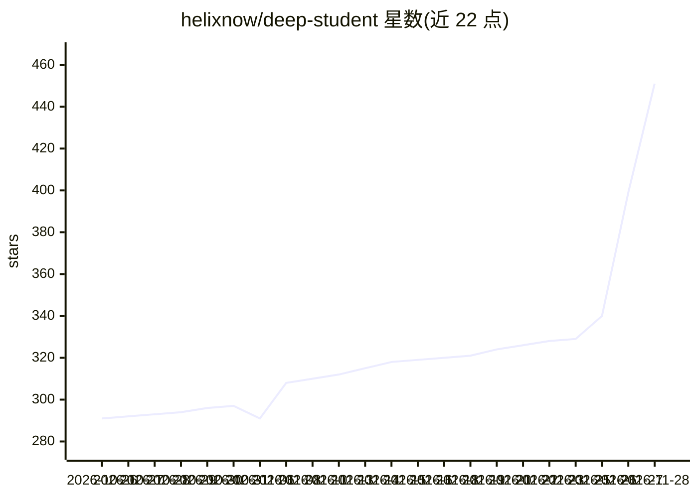

# helixnow/deep-student

⭐ 451 · TypeScript · AGPL-3.0 · 推送 2026-11-27 · [GitHub](https://github.com/helixnow/deep-student) · [官网](https://www.deepstudent.cn) · 组织维护 · 中文 README

**本地优先的 AI 学习工作台，供学生一站式完成阅读、笔记与复习**

DeepStudent 是 Electron 桌面端的本地优先学习工作台，内置 12 个学习应用（聊天、笔记、思维导图、题库、闪卡、作文批改、翻译等），由自主学习 agent 直接在应用内写入结构化输出。支持 PDF/Word/EPUB 深读、课程音视频转录与 B 站导入、FSRS-6 间隔复习与 .apkg 双向导入、基于评分标准的作文打分。数据默认本地存储（SQLite/LanceDB），AGPL-3.0-or-later 许可，需自行配置模型 API key。

## 筛选速览

| 维度 | 判定 | 备注 |
|---|---|---|
| AI 角色 | `ai-native` | 本体是模型或模型工具 |
| 许可风险 | `viral` | AGPL-3.0 |
| 部署形态 | `desktop` | 安装包/桌面程序 |
| 模型依赖 | local-ok | 支持本地模型 |
| 硬件要求 | — | 无带数字的原话,不猜 |
| 安装摩擦 | `low` | 无编译、无系统依赖或容器化 |
| 成熟度 | — | 结构信号不足 |

## 能力要点

- 12 个原生学习应用由 agent 直接操作，输出写入目标应用
- FSRS-6 间隔复习，支持 .apkg 导入导出与 AnkiConnect 同步，无需安装 Anki
- 15 个预设模型提供商，支持无 key 本地 Ollama 与多模型对比
- 本地存储默认（SQLite/LanceDB），支持 QR 配对加密跨设备同步

## 适用场景

- 导入讲义或真题，按考试日期生成每日冲刺复习队列
- 精读长文献：语义高亮、区域问答、导出带批注 PDF 与关联笔记
- 转录本地录播课或导入 B 站课程，按时间戳提问与生成讲义

## 场景标签

`知识库管理` `文档问答` · 领域:知识与检索

## 证据(README 行号)

> L9: An open-source, local-first AI learning workbench.
> L10: Integrates 12 native study apps operated directly by an autonomous study agent.
> L74: - **Flexible model & search providers**: Ships with 15 preset model providers (automatic API key detection and slot

## 星数曲线

2026-10-26 291 → 2026-11-28 451（+160）

---
*卡片 v1 · prompt 1.4 · 生成 2026-11-28 · 置信度 high · 依据 README sha `9357a5bb7407` · [字段定义](../../DATASET.md)*
