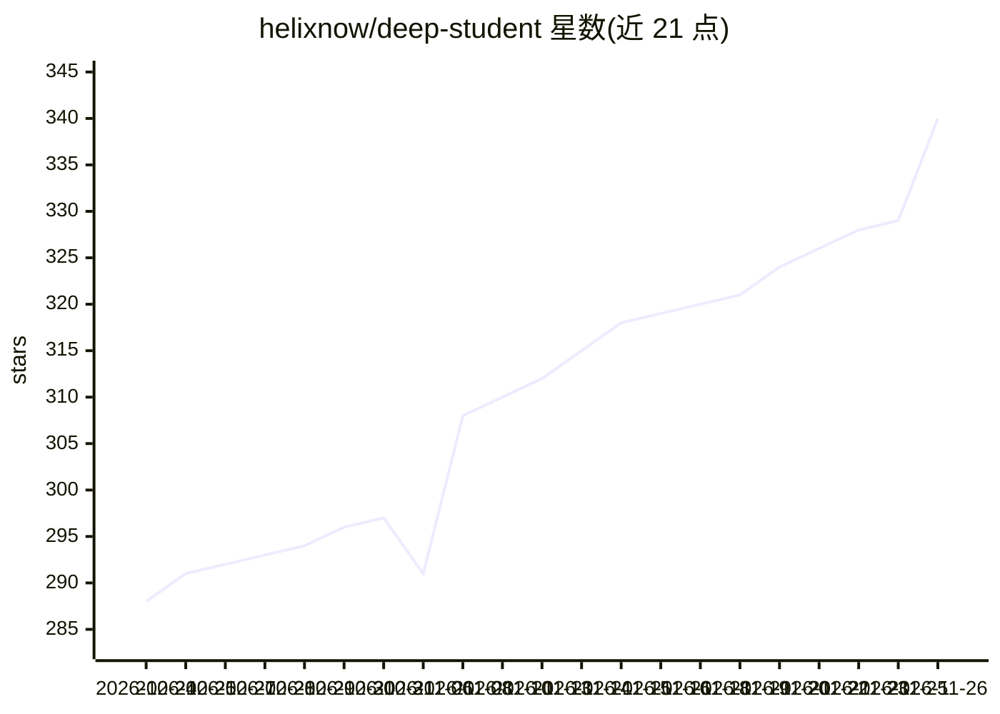

# helixnow/deep-student

⭐ 340 · TypeScript · AGPL-3.0 · 推送 2026-11-25 · [GitHub](https://github.com/helixnow/deep-student) · [官网](https://www.deepstudent.cn) · 组织维护 · 中文 README

**面向学生的本地优先 AI 学习工作台：一句话生成笔记/导图/题卡**

DeepStudent 是一个开源、本地优先的 AI 学习工作台，提供聊天、文件、媒体转写、教材阅读、笔记、思维导图、试卷集、闪卡（FSRS 间隔重复）、作文批改、翻译等应用组成的 Study Desktop，学习 Agent 可在各应用内直接产出并写入结果。数据本地存储（SQLite/LanceDB），答案引用 PDF 页码或讲义时间戳；支持 13 个模型提供商、9 个搜索引擎、6 个 OCR 引擎、58 个内置技能、MCP 外接工具与 AI 插件工坊。AGPL-3.0-or-later 许可。

## 筛选速览

| 维度 | 判定 | 备注 |
|---|---|---|
| AI 角色 | `ai-native` | 本体是模型或模型工具 |
| 许可风险 | `viral` | AGPL-3.0 |
| 部署形态 | `desktop` | 安装包/桌面程序 |
| 模型依赖 | locked-api |  |
| 硬件要求 | — | 无带数字的原话,不猜 |
| 安装摩擦 | `medium` | 含编译或系统依赖之一 |
| 成熟度 | — | 结构信号不足 |

## 能力要点

- Agent 在每个应用内产出笔记、思维导图、题目、闪卡与复习计划
- 13 个模型提供商、9 个搜索引擎与 6 个 OCR 引擎内置
- FSRS-6/7 间隔重复、APKG 导入导出与 Anki 同步
- 本地存储（SQLite/LanceDB），答案带 PDF 页码/时间戳引用回链

## 适用场景

- 把教材章节导入后生成思维导图与复习闪卡
- 转写录课音频并按时间戳引用提问
- 按高考/雅思/考研等评分标准做作文批改
- 多设备间用 WebDAV/S3 同步学习数据

## 场景标签

`知识库管理` `RAG` `语音识别` `OCR` · 领域:知识与检索

## 证据(README 行号)

> L9: An open-source, local-first AI learning workbench.
> L39: Notes, mind maps, exam sets, flashcards, todos, essay review and translation all have agent tools, so results land 
> L65: |**Flashcards**|Review, card making and templates in one place: built-in FSRS-6 spaced repetition (plus an isolated

## 星数曲线

2026-10-24 288 → 2026-11-26 340（+52）

---
*卡片 v1 · prompt 1.4 · 生成 2026-11-25 · 置信度 high · 依据 README sha `4aee3fa187f4` · [字段定义](../../DATASET.md)*
