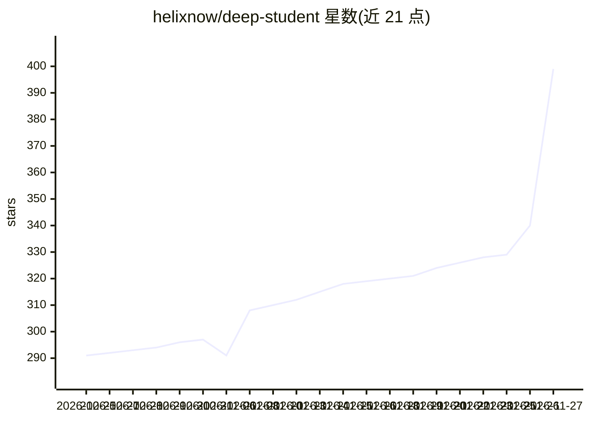

# helixnow/deep-student

⭐ 399 · TypeScript · AGPL-3.0 · 推送 2026-11-26 · [GitHub](https://github.com/helixnow/deep-student) · [官网](https://www.deepstudent.cn) · 组织维护 · 中文 README

**本地优先的开源 AI 学习工作台：代理直接在各学习应用中干活**

基于 Electron + Capacitor + Cordis 微内核的开源学习工作台，桌面端默认呈现 Study Desktop。学习代理通过各应用内的工具直接生成并落盘笔记、思维导图、试题集、闪卡、待办、作文批改与翻译，并支持录音讲座转时间戳笔记、联网检索学术论文、产出 Word/PowerPoint/Excel 文件。机制包括按风险级别审批动作、Ask/Plan/Craft 权限模式、可撤销编辑与引用回链；Memory v2 维护学习者画像，58 个内置技能按需加载，支持 MCP、15 个预设模型供应商、9 个搜索引擎与 6 个 OCR 引擎。数据（SQLite、LanceDB）默认存本地，AGPL-3.0-or-later 许可。

## 筛选速览

| 维度 | 判定 | 备注 |
|---|---|---|
| AI 角色 | `ai-native` | 本体是模型或模型工具 |
| 许可风险 | `viral` | AGPL-3.0 |
| 部署形态 | `desktop` | 安装包/桌面程序 |
| 模型依赖 | locked-api |  |
| 硬件要求 | — | 无带数字的原话,不猜 |
| 安装摩擦 | `medium` | 含编译或系统依赖之一 |
| 成熟度 | — | 结构信号不足 |

## 能力要点

- 代理工具将结果直接写入各学习应用而非停留在聊天窗口
- Flashcards 内置 FSRS-6 间隔重复，支持 .apkg 导入导出与 AnkiConnect v6 同步
- Memory v2 学习者画像带 10 版本回滚与逐条消息归因；Plugin v2 支持零代码 .dspack 分享包
- 多平台安装包：macOS/Windows/Linux/Android 及自托管 WebUI

## 适用场景

- 把录播讲座转成带时间戳的笔记并针对内容提问
- 从教材或往年试题生成闪卡与练习题备考冲刺
- 阅读长论文时做分栏对话、五色高亮与可点击引用笔记
- 按高考/雅思/考研评分标准做作文批改

## 场景标签

`知识库管理` `RAG` `文档问答` · 领域:知识与检索

## 证据(README 行号)

> L9: An open-source, local-first AI learning workbench.
> L36: ## A study agent that works in every app
> L38: One sentence is enough. The agent opens the right app and produces the notes, mind maps, questions, cards and revie

## 星数曲线

2026-10-25 291 → 2026-11-27 399（+108）

---
*卡片 v1 · prompt 1.4 · 生成 2026-11-27 · 置信度 high · 依据 README sha `7464c5aef954` · [字段定义](../../DATASET.md)*
