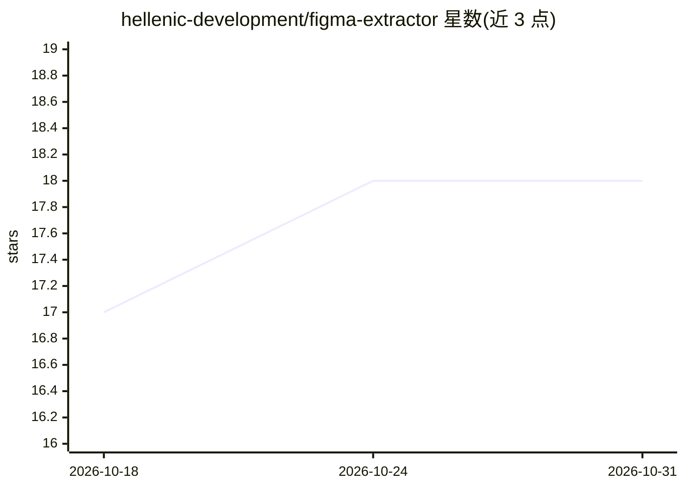

# hellenic-development/figma-extractor

⭐ 18 · Go · BSD-3-Clause · 推送 2026-04-01 · [GitHub](https://github.com/hellenic-development/figma-extractor) · [官网](https://hellenic.dev) · 组织维护

**从 Figma 文件提取设计规格为 Markdown 供 AI 实现的 Go CLI 工具**

Go 编写的命令行工具，通过 Figma REST API 与个人访问令牌读取 Figma 文件，递归遍历文档树，提取颜色、字体、间距、阴影、圆角与布局尺寸，经分类、去重与标准化后生成含 CSS 变量的 Markdown 规格文档，并可批量导出 PNG/SVG/JPG/PDF 资产。生成的文档供 Claude、ChatGPT 等 AI 配合实现 UI 使用；工具本身不调用模型，需 Figma 访问令牌。安装方式为 go install，面向使用 Figma 进行设计转代码的开发者。

## 筛选速览

| 维度 | 判定 | 备注 |
|---|---|---|
| AI 角色 | `ai-enhanced` | 去掉 AI 部分产品仍成立 |
| 许可风险 | `permissive` | BSD-3-Clause |
| 部署形态 | `library` | 以包/库形式分发 |
| 模型依赖 | — | README 未给出锁定关系 |
| 硬件要求 | — | 无带数字的原话,不猜 |
| 安装摩擦 | `low` | 无编译、无系统依赖或容器化 |
| 成熟度 | — | 结构信号不足 |

## 能力要点

- 整文件或指定节点提取设计规格，输出 CSS 变量形式的 Markdown
- 自动从分享链接解析 node-id，支持多节点提取
- 批量并发导出图片资产（PNG/SVG/JPG/PDF，多倍率）
- 生成文档面向 Claude/ChatGPT 等 AI 辅助实现 UI

## 适用场景

- 把 Figma 设计稿转成规格文档交给 AI 生成前端代码
- 提取设计系统的颜色/字体/间距规范
- 按节点导出组件规格与切图资产

## 场景标签

 · 领域:设计工具/前端开发

## 证据(README 行号)

> L3: A Go tool to extract design specifications from Figma files using the Figma REST API. This tool automatically extrac
> L214: The generated markdown file is specifically formatted to work with Claude Sonnet 4.5, ChatGPT and e.t.c. for imple

## 星数曲线

2026-10-18 17 → 2026-10-31 18（+1）

---
*卡片 v1 · prompt 1.4 · 生成 2026-10-29 · 置信度 high · 依据 README sha `b9dd4af7dc0c` · [字段定义](../../DATASET.md)*
