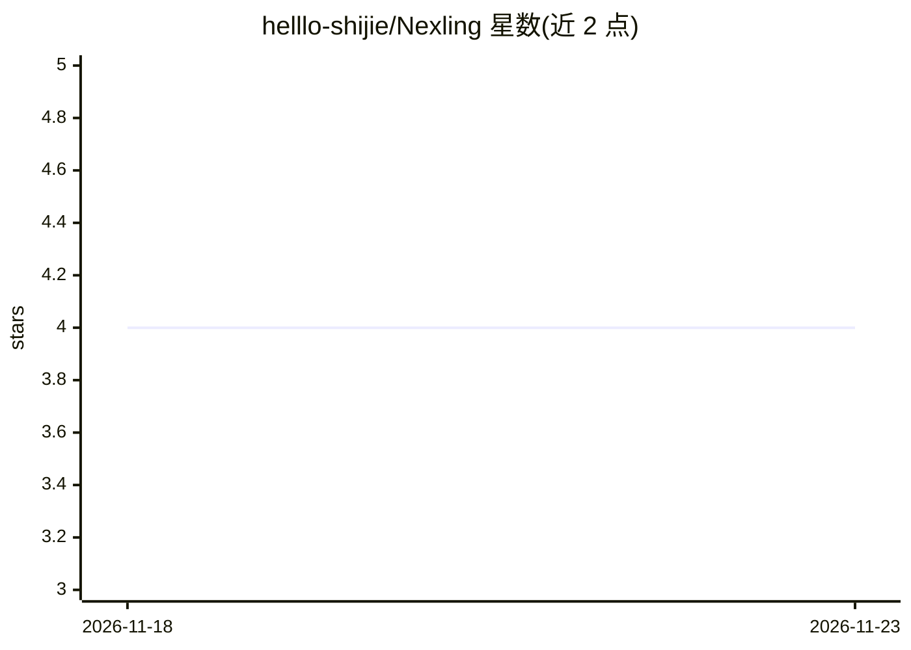

# helllo-shijie/Nexling

⭐ 4 · Python · 推送 2026-11-16 · [GitHub](https://github.com/helllo-shijie/Nexling) · 个人维护 · 中文 README

**面向技术人才的本地桌面 LLM 翻译工作台**

纯本地的纯文本翻译客户端，Python 核心（laa_core）+ React 前端 + WebView2 桌面窗口。默认走内置离线 FakeProvider 产出确定性伪译文，配置 OpenAI 兼容接口（DeepSeek/OpenAI/Claude 预设）后调用真实模型。提供流畅/直译双模式（直译含逐词义项点选改句）、术语库（导入导出、场景译词、候选自动审批）、语气标注、长文本分批与断点续传、token 用量账单。API Key 经 Windows DPAPI 加密本地存储，数据写 SQLite，不上传译文。

## 筛选速览

| 维度 | 判定 | 备注 |
|---|---|---|
| AI 角色 | `ai-native` | 本体是模型或模型工具 |
| 许可风险 | `none` | — |
| 部署形态 | `desktop` | 安装包/桌面程序 |
| 模型依赖 | — | README 未给出锁定关系 |
| 硬件要求 | — | 无带数字的原话,不猜 |
| 安装摩擦 | `low` | 无编译、无系统依赖或容器化 |
| 成熟度 | `idea` | |

## 能力要点

- 直译模式逐词翻译并提供可点选的推荐/备选义项，选中后重建整句
- 术语库支持 JSON 导入导出、场景译词、候选发现与自动审批
- 长文本分层切分、分批请求、失败片段重试与断点续传
- 每次调用的 token 用量、花费与完整提示词本地可查

## 适用场景

- 离线或自备 API Key 翻译技术文档并保持术语全篇一致
- 逐词核对直译结果并改选义项后重建译文
- 导出 TXT/双语 Markdown/JSON 多格式翻译结果
- 本地留存翻译历史与调用账单明细

## 场景标签

 · 领域:语言工具/翻译

## 证据(README 行号)

> L3: 一个**纯本地、离线可用的纯文本翻译客户端**（内核即 Language-Accessible Agent）。Python 核心 +
> L41: 默认走内置离线引擎（FakeProvider）。要接 DeepSeek/OpenAI 等 **OpenAI 兼容接口**：
> L130: - **按词翻译**：模型按原文词序逐词/逐词组对译，不合并、不省略、不意译，保持原句结构与语序；

## 星数曲线

2026-11-18 4 → 2026-11-23 4（+0）

---
*卡片 v1 · prompt 1.4 · 生成 2026-11-21 · 置信度 mid · 依据 README sha `396e6257edc9` · [字段定义](../../DATASET.md)*
