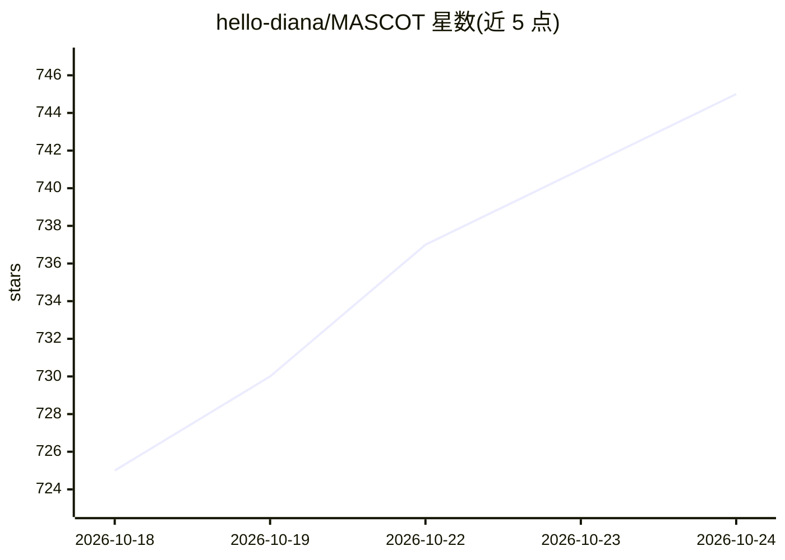

# hello-diana/MASCOT

⭐ 745 · Python · Apache-2.0 · 推送 2026-08-24 · [GitHub](https://github.com/hello-diana/MASCOT) · [官网](https://hello-diana.github.io/MASCOT/) · 组织维护

**多 agent 社交陪伴系统的双层优化训练框架**

面向多视角社交陪伴场景（情感支持、职场会议）的多 agent LLM 训练框架。两阶段流水线：先用 RLAIF（rubric 评审构建偏好对、训练 Qwen3-0.6B 奖励模型、GRPO 微调 Speaker）保持个体 persona 一致；再用 Director 编排 agent 的发言轮转并以组级奖励做 GRPO 优化。全部环节（episode 生成、评审、奖励建模、GRPO/DPO 训练、评测）对接 OpenAI 兼容的 vLLM 服务器，策略以 LoRA 适配器训练，提供 8 步 Quick Start 命令。另保留离线 DPO 作为可选路径。

## 筛选速览

| 维度 | 判定 | 备注 |
|---|---|---|
| AI 角色 | `ai-ecosystem` | LLM/agent 周边工具 |
| 许可风险 | `permissive` | Apache-2.0 |
| 部署形态 | `library` | 以包/库形式分发 |
| 模型依赖 | local-ok | 支持本地模型 |
| 硬件要求 | — | 无带数字的原话,不猜 |
| 安装摩擦 | `low` | 无编译、无系统依赖或容器化 |
| 成熟度 | — | 结构信号不足 |

## 能力要点

- 两阶段流水线：Speaker persona 对齐 + Director 协作对话优化
- RLAIF + GRPO 训练，Speaker/Director 仅训练 LoRA 适配器（0.187% 参数）
- 自带完整管线：episode 生成、rubric 评审、奖励建模、训练与评测，对接 vLLM 服务器
- 支持 Big Five 人格模拟用户与多角色 LoRA 别名同服务器部署

## 适用场景

- 训练具有稳定独立人设的多 agent 陪伴/会议系统
- 复现论文在 Empathetic Dialogues / QMSum 上的实验流程
- 研究多 agent 系统的 persona 崩塌与社会迎合问题

## 场景标签

`多智能体` `强化学习` `微调` · 领域:Agent 开发

## 证据(README 行号)

> L3: Social interaction shapes well-being, mental health, and cognition — yet an estimated **1 in 6** people worldwide la
> L28: - 📦 **Self-contained pipeline** — episode generation, rubric judging, preference-data construction, reward modeling

## 星数曲线

2026-10-18 725 → 2026-10-24 745（+20）

---
*卡片 v1 · prompt 1.4 · 生成 2026-10-21 · 置信度 high · 依据 README sha `116847ce995a` · [字段定义](../../DATASET.md)*
