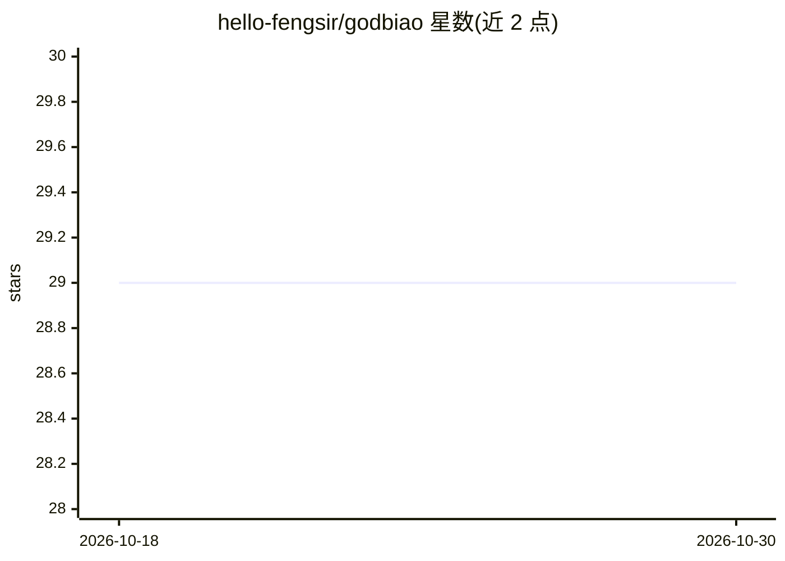

# hello-fengsir/godbiao

⭐ 29 · HTML · MIT · 推送 2026-06-14 · [GitHub](https://github.com/hello-fengsir/godbiao) · 个人维护 · 中文 README

**AI 招投标工具：上传标书与招标要求，逐条核查比对**

面向招投标场景的 Web 应用（FastAPI + Docker 部署），含两大工具：评标——解析 PDF/Word/图片(OCR)/文本格式的投标文件，调用 DeepSeek/OpenAI/通义千问等 OpenAI 兼容 API 的 10+ 大模型，自动提取招标要求并逐条比对投标响应，另提供格式评估与金额、货期、资质等关键信息提取；制标——类别→产品线→参数三级管理，支持 Excel 批量导入与一键导出 Word 技术参数表。API Key 仅存浏览器 localStorage，服务器不落盘。项目声明仅供学习交流，禁止商业用途。

## 筛选速览

| 维度 | 判定 | 备注 |
|---|---|---|
| AI 角色 | `ai-native` | 本体是模型或模型工具 |
| 许可风险 | `permissive` | MIT |
| 部署形态 | `self-host` | docker 或自建部署 |
| 模型依赖 | — | README 未给出锁定关系 |
| 硬件要求 | — | 无带数字的原话,不猜 |
| 安装摩擦 | `low` | 无编译、无系统依赖或容器化 |
| 成熟度 | — | 结构信号不足 |

## 能力要点

- 多格式解析：PDF / Word / 图片(OCR) / 纯文本
- AI 逐项核查（三路并行分析）+ 格式评估 + 关键信息提取
- 支持 DeepSeek / OpenAI / 通义千问等 10+ 大模型
- Docker Compose 一键部署，API Key 仅存浏览器端

## 适用场景

- 投标前核对投标文件是否逐条满足招标要求
- 批量管理产品技术参数并导出 Word 参数表
- 检查标书格式问题与商务关键信息

## 场景标签

`OCR` `文档解析` · 领域:知识与检索

## 证据(README 行号)

> L3: > AI 智能招投标工具 — 评标：上传标书自动逐条核查 · 制标：参数化管理一键导出
> L37: - 📊 **逐项核查** — AI 自动提取招标要求，逐条比对投标响应（三路并行分析）

## 星数曲线

2026-10-18 29 → 2026-10-30 29（+0）

---
*卡片 v1 · prompt 1.4 · 生成 2026-10-26 · 置信度 high · 依据 README sha `1d2289a76486` · [字段定义](../../DATASET.md)*
