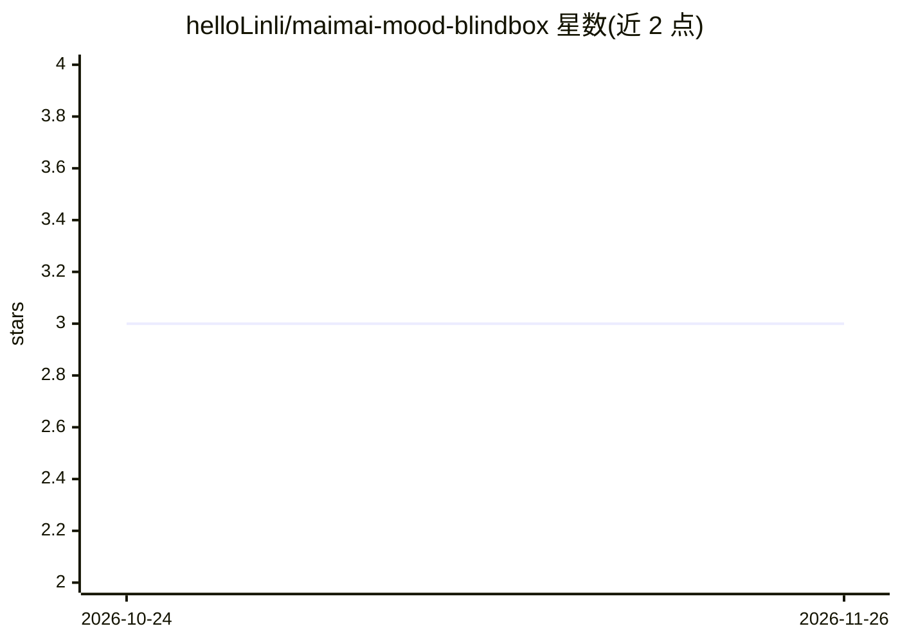

# helloLinli/maimai-mood-blindbox

⭐ 3 · JavaScript · MIT · 推送 2026-10-11 · [GitHub](https://github.com/helloLinli/maimai-mood-blindbox) · 个人维护 · 中文 README

**把心情与预算/忌口/热量约束翻译成麦当劳套餐与情绪小票的 AI 盲盒 Demo**

面向决策疲劳的用餐场景：用户说一句心情并补充预算、人数、辣度、忌口、热量上限，系统调麦当劳 MCP 获取当前门店真实菜单与营养数据，经硬过滤、组合枚举、加权打分产出 3 个套餐，再由「日期+心情+约束」哈希确定开盒结果，生成含套餐明细、推荐理由、小票诗、取餐码与语音祝福的情绪小票。提供网页 Demo（GitHub Pages 离线演示菜单）、CLI（Node ≥18，零第三方依赖）与 SKILL.md 形式的 Agent Skill 接入方式；无 MCP Token 时自动降级为演示模式并标注。

## 筛选速览

| 维度 | 判定 | 备注 |
|---|---|---|
| AI 角色 | `ai-native` | 本体是模型或模型工具 |
| 许可风险 | `permissive` | MIT |
| 部署形态 | `None` |  |
| 模型依赖 | — | README 未给出锁定关系 |
| 硬件要求 | — | 无带数字的原话,不猜 |
| 安装摩擦 | `low` | 无编译、无系统依赖或容器化 |
| 成熟度 | — | 结构信号不足 |

## 能力要点

- 预算/忌口/辣度/热量为硬过滤+硬校验，超预算时降级并写明省掉了什么
- 开盒结果由确定性哈希决定，同一天同一心情结果可复现
- 真实调用麦当劳 MCP（mcp.mcd.cn，约 6-9 次调用），含领券后试算到手价
- CLI 自检 58 项断言与 528 张小票版式检查

## 适用场景

- 午休十分钟内按心情和预算决定吃什么
- 减脂期把热量和蛋白质先算清再点餐
- 帮多位同事带饭时按人数放大份数并控总额
- 把 SKILL.md 交给 Agent 用自然语言开盲盒

## 场景标签

`AI 助手` · 领域:对话与助手

## 证据(README 行号)

> L12: 麦麦心情盲盒做一件事：**把「心情 + 预算 + 忌口 + 热量」翻译成一份算得清、拿得走、说得出口的餐**。
> L16: 3. 它调麦当劳 MCP 拿**当前门店真实可售菜单与营养数据**，生成 3 个盲盒套餐；
> L166: 本项目**真实调用**麦当劳 MCP（`https://mcp.mcd.cn`，Streamable HTTP）。一次完整体验约 6-9 次调用：

## 星数曲线

2026-10-24 3 → 2026-11-26 3（+0）

---
*卡片 v1 · prompt 1.4 · 生成 2026-11-21 · 置信度 high · 依据 README sha `3689b8a5de8d` · [字段定义](../../DATASET.md)*
