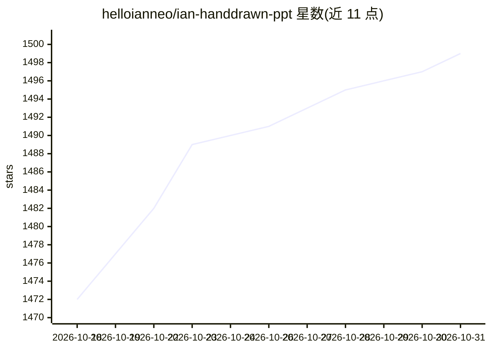

# helloianneo/ian-handdrawn-ppt

⭐ 1,499 · MIT · 推送 2026-10-27 · [GitHub](https://github.com/helloianneo/ian-handdrawn-ppt) · [官网](https://ianneo.xyz) · 个人维护 · 中文 README

**让 Codex Agent 生成中文手绘技术解释图整页 PNG 的 Skill**

一个 Codex Skill，用于指导 AI Agent 把文章、课程笔记、提纲或已有材料转换为一组中文手绘技术解释风格的整页 PNG 图：默认输出 21:9 封面、16:9 正文配图、多页 contact sheet 与 slide blueprint 摘要。工作流程为读取材料、intake 判断、规划叙事、选择页面 archetype、锁定视觉 DNA、逐页写图像 prompt 并生图检查。面向写中文技术文章与做课件的内容创作者，不输出可编辑 PPTX/PDF，推荐使用 ChatGPT Image 2.0 或可用的高质量图像模型。通过 git clone 复制到 Codex skills 目录安装。

## 筛选速览

| 维度 | 判定 | 备注 |
|---|---|---|
| AI 角色 | `ai-ecosystem` | LLM/agent 周边工具 |
| 许可风险 | `permissive` | MIT |
| 部署形态 | `None` |  |
| 模型依赖 | — | README 未给出锁定关系 |
| 硬件要求 | — | 无带数字的原话,不猜 |
| 安装摩擦 | `low` | 无编译、无系统依赖或容器化 |
| 成熟度 | — | 结构信号不足 |

## 能力要点

- 21:9 封面 + 16:9 正文配图的整页 PNG 输出
- 内容语义→叙事规划→页面 archetype→图像 prompt 的工作流程
- 统一手绘视觉 DNA 与多页 contact sheet 检查
- 支持只规划不生图的 blueprint 模式

## 适用场景

- 给中文技术文章生成封面图和正文配图
- 把课程大纲或讲稿整理成视觉化课件页
- 把长文提纲变成知识卡片式解释图

## 场景标签

`图像生成` · 领域:内容生成

## 证据(README 行号)

> L9: Ian Handdrawn PPT 是一个 Codex Skill，用来指导 AI Agent 把内容整理成**中文手绘技术解释图**。
> L21: 推荐生图模型：**最好使用 ChatGPT Image 2.0**。如果当前环境没有这个模型，就使用可用的最高质量图像模型，并尽量让整套图保持同一个模型、同一套 style lock。

## 星数曲线

2026-10-18 1,472 → 2026-10-31 1,499（+27）

---
*卡片 v1 · prompt 1.4 · 生成 2026-10-21 · 置信度 high · 依据 README sha `de4e8e681dc3` · [字段定义](../../DATASET.md)*
