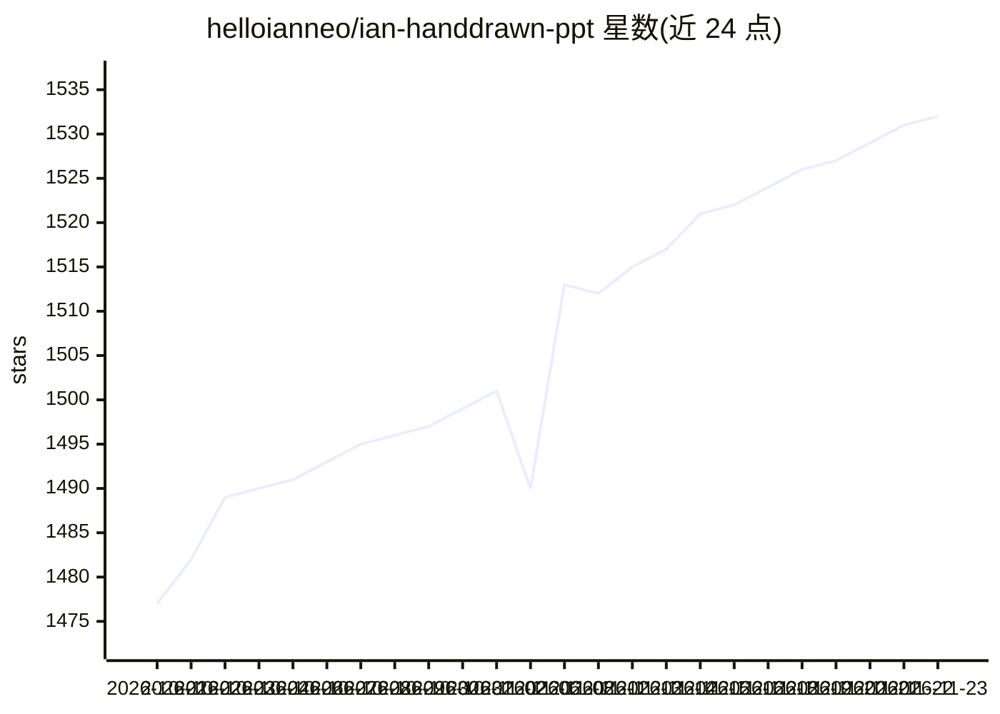

# helloianneo/ian-handdrawn-ppt

⭐ 1,532 · MIT · 推送 2026-10-27 · [GitHub](https://github.com/helloianneo/ian-handdrawn-ppt) · [官网](https://ianneo.xyz) · 个人维护 · 中文 README

**指导 AI Agent 生成中文手绘风格 PPT 页面图的 Codex Skill**

一个 Codex Skill（提示词指令集），将文章、课程笔记、提纲等材料经读取、intake、叙事规划、版式选择、视觉 DNA 锁定等八步流程，逐页生成图像 prompt 并输出 21:9 封面与 16:9 正文的整页 PNG 图，多页时附带 contact sheet。面向写中文技术文章、做课件与知识卡片的内容创作者。限制：不输出可编辑 PPTX、PDF、SVG 等格式，且中文渲染可能出现错字需多次生成挑选，推荐使用 ChatGPT Image 2.0 并保持同一模型与 style lock。

## 筛选速览

| 维度 | 判定 | 备注 |
|---|---|---|
| AI 角色 | `ai-native` | 本体是模型或模型工具 |
| 许可风险 | `permissive` | MIT |
| 部署形态 | `None` |  |
| 模型依赖 | — | README 未给出锁定关系 |
| 硬件要求 | — | 无带数字的原话,不猜 |
| 安装摩擦 | `low` | 无编译、无系统依赖或容器化 |
| 成熟度 | — | 结构信号不足 |

## 能力要点

- 八步流程：读取材料→叙事规划→页面 archetype→逐页图像 prompt→生图检查
- 统一锁定手绘视觉 DNA（纸底、线条、色彩、图形尺度），多页风格一致
- 支持读取文章、Markdown、PDF、DOCX、PPTX 等输入素材
- 支持只规划不生图的 slide blueprint 模式

## 适用场景

- 为中文技术文章生成封面图和正文配图
- 把课程大纲整理成整套手绘课件页面图
- 把长文、提纲、讲稿变成视觉化知识卡片
- 先规划页面叙事结构再决定是否生图

## 场景标签

`图像生成` · 领域:内容生成

## 证据(README 行号)

> L9: Ian Handdrawn PPT 是一个 Codex Skill，用来指导 AI Agent 把内容整理成**中文手绘技术解释图**。
> L16: - 每页生成一张完整 raster image
> L21: 推荐生图模型：**最好使用 ChatGPT Image 2.0**。如果当前环境没有这个模型，就使用可用的最高质量图像模型，并尽量让整套图保持同一个模型、同一套 style lock。

## 星数曲线

2026-10-21 1,477 → 2026-11-23 1,532（+55）

---
*卡片 v1 · prompt 1.4 · 生成 2026-11-23 · 置信度 high · 依据 README sha `624189089263` · [字段定义](../../DATASET.md)*
