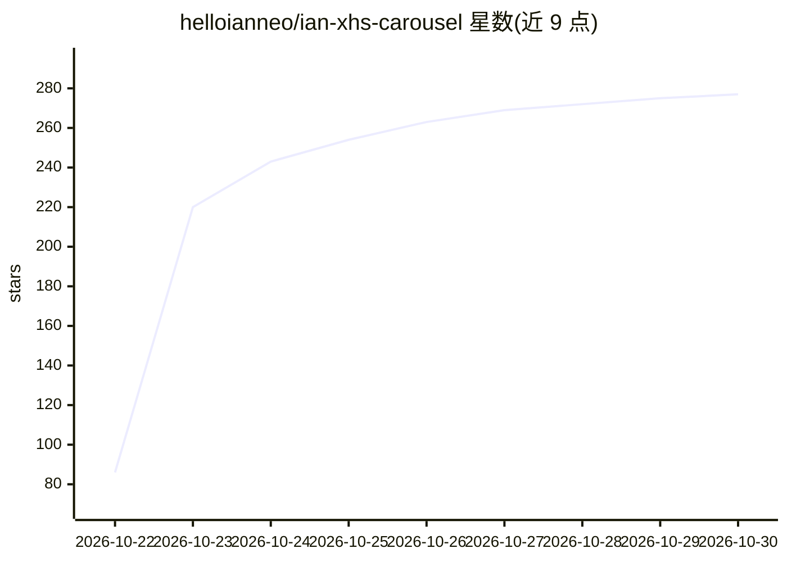

# helloianneo/ian-xhs-carousel

⭐ 277 · HTML · MIT · 推送 2026-10-21 · [GitHub](https://github.com/helloianneo/ian-xhs-carousel) · [官网](https://www.ianneo.xyz) · 个人维护 · 中文 README

**把文章/笔记排成小红书轮播图的 Claude Code Skill**

面向使用 Claude Code 的内容创作者的 AI Skill：输入文章、案例或笔记，先生成分镜表供确认，再基于 20 个母版（覆盖封面、步骤、对比、数据、代码等场景）排版并渲染为 1080×1440 的 3:4 竖版 PNG 轮播图，支持浅色/深色两版，同时交付 HTML 源文件供二次修改。渲染依赖 Playwright 与 Pillow，联网加载字体。不适合手绘、插画、大色块海报风格；帖子标题、正文与话题标签需用户自行撰写。

## 筛选速览

| 维度 | 判定 | 备注 |
|---|---|---|
| AI 角色 | `ai-native` | 本体是模型或模型工具 |
| 许可风险 | `permissive` | MIT |
| 部署形态 | `library` | 以包/库形式分发 |
| 模型依赖 | locked-api |  |
| 硬件要求 | — | 无带数字的原话,不猜 |
| 安装摩擦 | `low` | 无编译、无系统依赖或容器化 |
| 成熟度 | — | 结构信号不足 |

## 能力要点

- 20 个母版覆盖封面/步骤/对比/数据/代码等场景，母版不合适时 AI 可按同一套样式拼新排法
- 分镜表先确认再排版，渲染前自查文字溢出、字号、配色
- 输出 1080×1440 PNG 每页一张 + 总览图 + 可改的 HTML 源文件
- 浅色/深色两版，版式一致

## 适用场景

- 把文章或案例拆解快速做成一组小红书图文
- 让每期 AI/产品/设计类内容的图文风格保持统一
- 只要分镜表先看分页方案，确认后再出图

## 场景标签

`图像生成` · 领域:内容生成

## 证据(README 行号)

> L11: Ian XHS Carousel 是一个 AI Skill，把你的内容做成一组小红书轮播图，风格是简洁的产品界面风。
> L58: **1. 下载并复制到 Claude Code**

## 星数曲线

2026-10-22 86 → 2026-10-30 277（+191）

---
*卡片 v1 · prompt 1.4 · 生成 2026-10-22 · 置信度 mid · 依据 README sha `aa1df5e3f978` · [字段定义](../../DATASET.md)*
