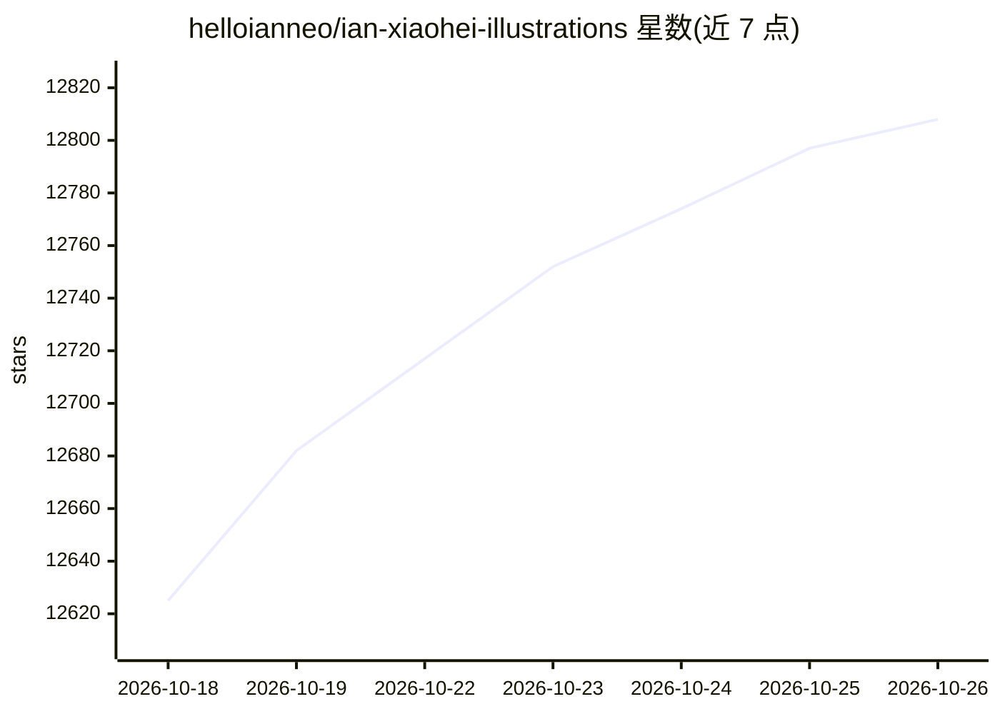

# helloianneo/ian-xiaohei-illustrations

⭐ 12,808 · MIT · 推送 2026-09-24 · [GitHub](https://github.com/helloianneo/ian-xiaohei-illustrations) · [官网](https://www.ianneo.xyz) · 个人维护 · 中文 README

**Codex Skill：为中文文章生成小黑怪诞手绘正文配图**

一个安装到 Codex skills 目录的 Skill，指导 AI Agent 为中文文章、博客、Notion 文档等生成正文配图：先读取内容、提炼认知锚点，输出 shot list（每篇 4-8 张），再按 8 种结构类型选择构图、设计低科技物理隐喻，让固定视觉 IP「小黑」承担核心动作，逐张调用图像模型生成 16:9 纯白底手绘 PNG 并保存到 workspace。面向用 Codex 做中文内容生产的写作者；不产出可编辑矢量、PPT 或商业插画，生成后需人工检查中文错字与风格漂移。

## 筛选速览

| 维度 | 判定 | 备注 |
|---|---|---|
| AI 角色 | `ai-native` | 本体是模型或模型工具 |
| 许可风险 | `permissive` | MIT |
| 部署形态 | `None` |  |
| 模型依赖 | — | README 未给出锁定关系 |
| 硬件要求 | — | 无带数字的原话,不猜 |
| 安装摩擦 | `low` | 无编译、无系统依赖或容器化 |
| 成熟度 | — | 结构信号不足 |

## 能力要点

- 先分析文章认知锚点、输出 shot list 再逐张生图的流程
- 固定视觉 IP「小黑」+ 纯白底细线手绘 + 红橙蓝中文批注的风格约束
- 8 种结构类型（Workflow、概念隐喻、前后对比等）与生成后 QA checklist
- 以 git clone + 复制到 Codex skills 目录方式安装

## 适用场景

- 给中文博客或方法论文章生成 4-8 张风格统一的配图
- 把文章里的抽象判断画成具体隐喻图
- 在 Codex 内容生产流程中复用一套个人视觉语言

## 场景标签

`图像生成` `提示工程` · 领域:Agent 开发

## 证据(README 行号)

> L9: Ian Xiaohei Illustrations 是一个 Codex Skill，用来指导 AI Agent 为中文文章、帖子、博客、Notion 文档和方法论内容生成正文配图。
> L167: 7. 每张图单独调用图像模型生成
> L39: - 16:9 横版正文配图

## 星数曲线

2026-10-18 12,625 → 2026-10-26 12,808（+183）

---
*卡片 v1 · prompt 1.4 · 生成 2026-10-20 · 置信度 high · 依据 README sha `1aa152ed6e5d` · [字段定义](../../DATASET.md)*
