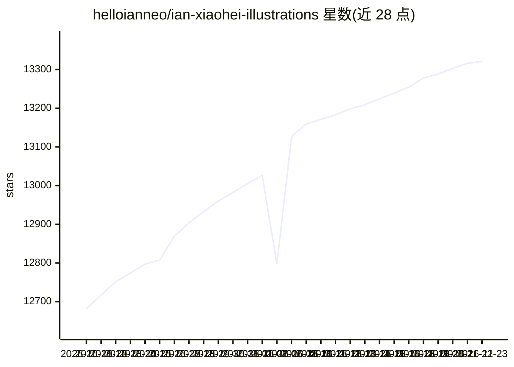

# helloianneo/ian-xiaohei-illustrations

⭐ 13,321 · MIT · 推送 2026-10-27 · [GitHub](https://github.com/helloianneo/ian-xiaohei-illustrations) · [官网](https://www.ianneo.xyz) · 个人维护 · 中文 README

**让 AI 为中文文章生成小黑风格配图的 Codex Skill**

一个安装在 Codex skills 目录的 Skill，指导 AI Agent 为中文文章、帖子、博客、Notion 文档生成正文配图。工作流程：读取文章内容、提炼认知锚点、输出 4-8 张图的 shot list、为每张图选择结构类型并构造物理隐喻，逐张调用图像模型生成 16:9 白底手绘 PNG，经 QA checklist 检查后保存到 workspace assets 目录。输出仅 PNG，不提供 PPTX/SVG 等可编辑格式；中文错字严重时需减少标注词重生成。

## 筛选速览

| 维度 | 判定 | 备注 |
|---|---|---|
| AI 角色 | `ai-native` | 本体是模型或模型工具 |
| 许可风险 | `permissive` | MIT |
| 部署形态 | `None` |  |
| 模型依赖 | — | README 未给出锁定关系 |
| 硬件要求 | — | 无带数字的原话,不猜 |
| 安装摩擦 | `low` | 无编译、无系统依赖或容器化 |
| 成熟度 | — | 结构信号不足 |

## 能力要点

- 为文章输出 shot list 与 4-8 张 16:9 白底手绘配图
- 固定视觉 IP"小黑"：黑色实心角色参与核心动作，红橙蓝中文手写批注
- 支持只规划不生图、单概念生图、图片编辑等用法
- 经 git clone 复制到 ${CODEX_HOME}/skills 目录安装

## 适用场景

- 为中文文章或博客生成正文配图
- 把方法论中的抽象判断画成隐喻插图
- 用 Codex 做内容生产时复用统一视觉风格

## 场景标签

`图像生成` · 领域:内容生成

## 证据(README 行号)

> L9: Ian Xiaohei Illustrations 是一个 Codex Skill，用来指导 AI Agent 为中文文章、帖子、博客、Notion 文档和方法论内容生成正文配图。
> L167: 7. 每张图单独调用图像模型生成

## 星数曲线

2026-10-21 12,682 → 2026-11-23 13,321（+639）

---
*卡片 v1 · prompt 1.4 · 生成 2026-11-22 · 置信度 high · 依据 README sha `4accfa945aaf` · [字段定义](../../DATASET.md)*
