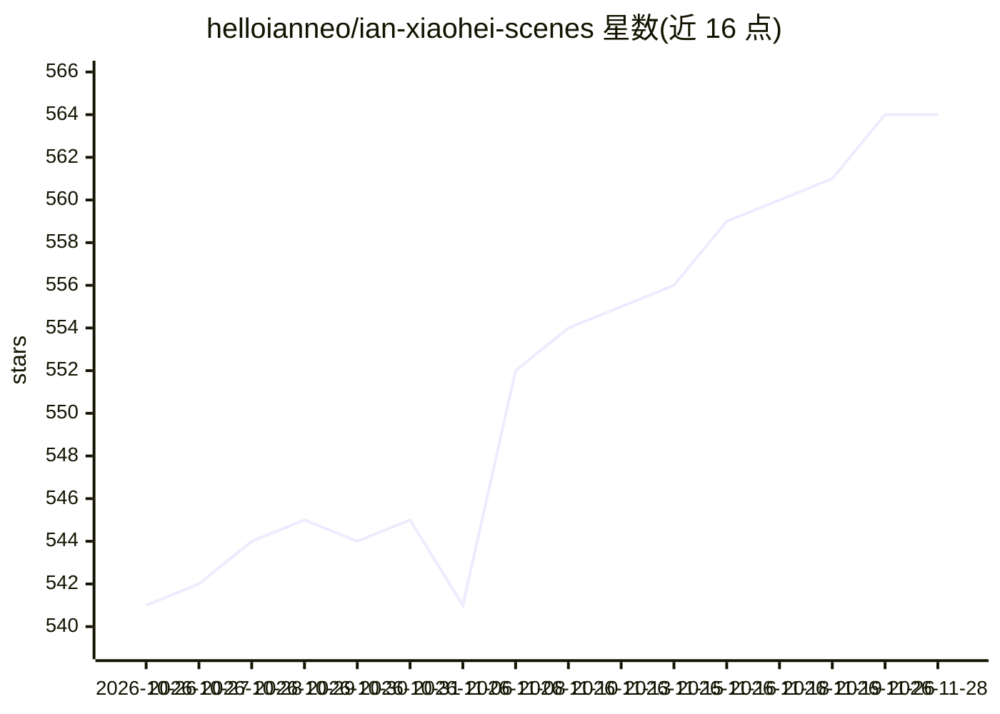

# helloianneo/ian-xiaohei-scenes

⭐ 564 · MIT · 推送 2026-10-27 · [GitHub](https://github.com/helloianneo/ian-xiaohei-scenes) · [官网](https://www.ianneo.xyz) · 个人维护 · 中文 README

**Codex Skill：为中文文章生成小黑实物场景配图**

一个安装到 Codex skills 目录的 Skill，指导 AI Agent 按固定视觉公式（小黑 + 真实物件 + 物理动作 + 短中文标签 + 留白叙事）为中文文章、帖子、项目复盘生成 16:9 正文配图，并支持超横版长卷故事图模式。工作流程为读取内容、提炼处境与物理动作、锁定 7 张母版之一、逐张调用图像模型生成并按 QA checklist 检查。通过 git clone 复制子目录安装，需在 Codex 环境中调用。

## 筛选速览

| 维度 | 判定 | 备注 |
|---|---|---|
| AI 角色 | `ai-native` | 本体是模型或模型工具 |
| 许可风险 | `permissive` | MIT |
| 部署形态 | `None` |  |
| 模型依赖 | — | README 未给出锁定关系 |
| 硬件要求 | — | 无带数字的原话,不猜 |
| 安装摩擦 | `low` | 无编译、无系统依赖或容器化 |
| 成熟度 | — | 结构信号不足 |

## 能力要点

- 标准模式生成 16:9 纯白背景实物场景正文配图
- 彩蛋长卷模式生成超横版故事图（5-8 个物件节点）
- 内置 7 张示例母版作为风格标尺与 QA checklist
- 支持仅输出 shot list 配图规划而不生图

## 适用场景

- 为中文文章、教程生成正文配图
- 把项目复盘或个人经历做成长卷故事图
- 在 Codex 内容生产流程中复用统一视觉语言

## 场景标签

`图像生成` · 领域:内容生成

## 证据(README 行号)

> L9: Ian Xiaohei Scenes 是一个 Codex Skill，用来指导 AI Agent 为中文文章、帖子、教程、案例、项目复盘和个人经历生成“小黑 2.0”视觉配图。
> L168: 7. 每张图单独调用图像模型生成

## 星数曲线

2026-10-26 541 → 2026-11-28 564（+23）

---
*卡片 v1 · prompt 1.4 · 生成 2026-11-25 · 置信度 high · 依据 README sha `b7712b455e25` · [字段定义](../../DATASET.md)*
