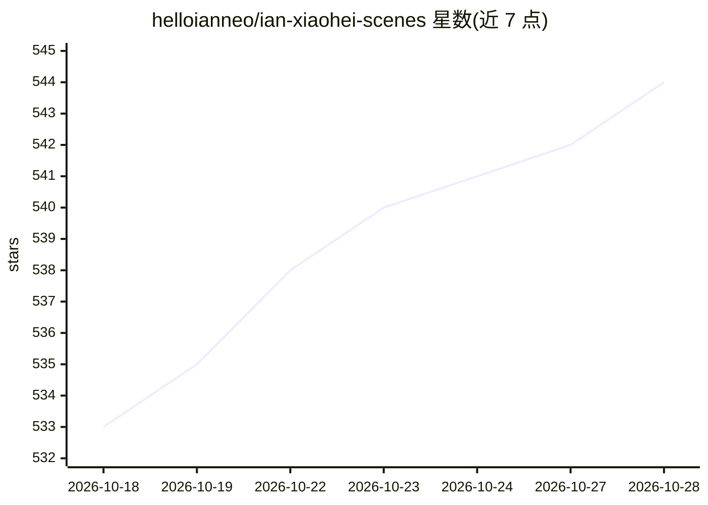

# helloianneo/ian-xiaohei-scenes

⭐ 545 · MIT · 推送 2026-10-27 · [GitHub](https://github.com/helloianneo/ian-xiaohei-scenes) · [官网](https://www.ianneo.xyz) · 个人维护 · 中文 README

**指导 AI Agent 为中文文章生成“小黑+真实物件”配图的 Codex Skill**

一个安装到 Codex skills 目录的 Skill，指导 AI Agent 阅读中文文章、帖子、项目复盘等内容，提炼处境与冲突后按“小黑 + 真实物件 + 物理动作 + 短中文标签 + 留白叙事”公式生成 16:9 正文配图或超横版彩蛋长卷故事图。提供 7 张母版作为风格标尺、工作流程九步与 QA checklist，逐张调用图像模型生成 PNG。限制：不产出可编辑矢量源文件，AI 图像模型可能出现中文错字、幻觉标签与风格漂移，生成后需检查。

## 筛选速览

| 维度 | 判定 | 备注 |
|---|---|---|
| AI 角色 | `ai-native` | 本体是模型或模型工具 |
| 许可风险 | `permissive` | MIT |
| 部署形态 | `None` |  |
| 模型依赖 | — | README 未给出锁定关系 |
| 硬件要求 | — | 无带数字的原话,不猜 |
| 安装摩擦 | `low` | 无编译、无系统依赖或容器化 |
| 成熟度 | — | 结构信号不足 |

## 能力要点

- 标准模式（16:9 正文配图）与彩蛋长卷模式（5-8 个物件节点的超横版故事图）两种生成模式
- 7 张母版作为质量标尺，要求学习比例与留白而非机械复刻
- 九步工作流含母版锁定、变异点提炼与 QA checklist（比例/留白/小黑动作/中文标签）
- git clone 后复制到 Codex skills 目录即可调用

## 适用场景

- 为中文文章、教程、项目复盘生成统一风格的正文配图
- 把个人经历或产品演化做成超横版长卷故事图
- 用 Codex 做内容生产时稳定复用一套视觉语言

## 场景标签

`图像生成` `提示工程` · 领域:Agent 开发

## 证据(README 行号)

> L9: Ian Xiaohei Scenes 是一个 Codex Skill，用来指导 AI Agent 为中文文章、帖子、教程、案例、项目复盘和个人经历生成“小黑 2.0”视觉配图。
> L168: 7. 每张图单独调用图像模型生成
> L170: 9. 保存最终 PNG，并报告用途和路径

## 星数曲线

2026-10-18 533 → 2026-10-28 544（+11）

---
*卡片 v1 · prompt 1.4 · 生成 2026-10-21 · 置信度 high · 依据 README sha `a87820cee365` · [字段定义](../../DATASET.md)*
